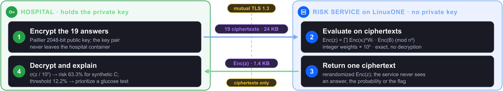

<p align="center">
  
</p>

# Privacy-preserving screening · Los Antimarrulla

**IBM Z Datathon 2026 · Theme 2: AI Secured.** A hospital estimates diabetes screening risk with an external AI service **without the service ever seeing patient data**. The hospital encrypts 19 survey answers with Paillier homomorphic encryption and keeps the private key; a risk service designed for IBM LinuxONE evaluates a logistic model directly on the ciphertexts and returns an encrypted score that only the hospital can open.

| | |
|---|---|
| Pitch deck (PDF) | [Los Antimarrulla_IBM Z Datathon 2026 Project.pdf](submission/Los%20Antimarrulla_IBM%20Z%20Datathon%202026%20Project.pdf) · [editable PPTX](submission/Los_Antimarrulla_Screening_Pitch.pptx) |
| Public site | [antimarrulla-tamizaje.netlify.app](https://antimarrulla-tamizaje.netlify.app) — pitch, data, [architecture atlas](https://antimarrulla-tamizaje.netlify.app/architecture) and [forecast dashboard](https://antimarrulla-tamizaje.netlify.app/forecast) |
| Architecture | [flowchart (PDF)](submission/flowchart/architecture.pdf) · [system diagrams and storage dictionary](docs/SYSTEM_DIAGRAMS.md) |
| Submission text | [Hack2Skill answers](submission/HACK2SKILL.md) |

<p align="center">
  
</p>

## How it works

1. **Hospital container** validates the 19 integer-coded answers and encrypts each one with a 2048-bit Paillier public key. The private key never leaves this container.
2. **Risk service** (no private key) computes the encrypted logit `Enc(z) = ∏ Enc(xᵢ)^Wᵢ · Enc(B) mod n²` with integer weights scaled by 10⁹, rerandomizes it and returns one ciphertext over mutual TLS 1.3.
3. **Hospital** decrypts `z`, applies the sigmoid and threshold, shows the largest model contributions and stores the evaluation in an AES-256-GCM vault.

Screening support, not diagnosis: the model predicts a self-reported survey label. All demo patients are synthetic.

## Reproduce it

Requirements: Python 3.12, Make and Docker (Docker alone is enough for the container route). Everything needed is in this repository: code, the public CDC dataset, the fixed splits, the exported model and its metrics. Secrets are generated outside the repository (`~/.screening` by default).

```bash
make verify          # 100+ tests, artifact hashes and an exact re-training check of the exported model
make demo            # build images, start hospital + risk service, run the A/B/C smoke test
```

Open <http://127.0.0.1:8080>, choose synthetic patient A, B or C (C gives 63.3%) or enter the 19 answers. The split screen shows ciphertexts at the service and the decrypted risk at the hospital. `make demo-down` stops it.

Without a host Python (for example on LinuxONE s390x, Ubuntu 24.04):

```bash
make verify-docker && make demo-docker
make measure-docker FINAL=1        # same CDC sample: floating vs fixed point vs Paillier, plus timings
make measure-api-docker FINAL=1    # deployed hospital API, 200 synthetic requests, remote hashes verified
make evidence-run PY=python3       # all of the above with logs and system identity, pushed for CI validation
```

Other entry points: `make model` (rebuild splits and retrain), `make ablation` (21 vs 19 features), `make forecast` (optional 52-week forecasts), `make rehearse-two-hosts` (hospital and service as separate hosts on one machine), `make package` (documentation and code ZIPs with SHA-256 manifest). Guides: [LinuxONE](docs/LINUXONE.md), [benchmark profiles](docs/BENCHMARK_PROFILES.md), [two hosts](docs/TWO_HOSTS.md), [deployment](docs/DEPLOYMENT.md).

## Results

Model `logistic-cdc19-v1` ([schema `cdc19-v1`](docs/SCHEMA_CDC19.md); Education and Income dropped with a validation AUC change of −0.0006) trained on CDC BRFSS 2015 (UCI 891, 253,680 records) with stratified 70/15/15 splits; threshold chosen on validation for ≥80% sensitivity.

| Held-out test (38,052) | ROC-AUC | AP | Sensitivity | Specificity | PPV | Brier |
|---|---:|---:|---:|---:|---:|---:|
| `logistic-cdc19-v1` | 0.825 | 0.414 | 0.807 | 0.689 | 0.296 | 0.098 |

Encrypted evaluation (local Mac/arm64 + Docker, clean commit `be9b27e`):

- 2,000/2,000 decrypted integers equal the fixed-point reference; ROC-AUC 0.806525 identical in floating, fixed-point and encrypted evaluation; maximum logit error 3.37×10⁻⁸ — [process evidence](submission/evidence/metrics/measurement_process_local-darwin-arm64_20261018T030142Z.json).
- Deployed two-container API: 200/200 exact, client p50 114.8 ms / p95 118.2 ms; 19 ciphertexts (24 KB) in, one encrypted score (1.4 KB) out — [API evidence](submission/evidence/metrics/measurement_api_local-darwin-arm64_20261018T030546Z.json).
- Earlier s390x audit (Mac hospital → LinuxONE risk service, 21-feature release): 10/10 checks, 200/200 exact — [audit](submission/evidence/two_hosts/auditoria_20261017T194931Z.md), [summary](docs/CARLOS_REMOTE_AUDIT.md). Recorded LinuxONE runs of this release land in `submission/evidence/runs/`.

Details: [project design and evaluation](docs/PROJECT.md), [data model](docs/DATA_MODEL.md), [data sources](docs/DATA_SOURCES.md), [ENSANUT experiment](docs/ENSANUT_EXPERIMENT.md), [forecast](docs/FORECAST.md).

## Limits and trust boundary

- The risk service receives only ciphertexts and has no private key. In the demo both containers share one VM, so its administrator is trusted; production places the hospital container on hospital premises.
- Mutual TLS authenticates the channel, not the computation; a malicious service is out of scope.
- CPACF is a LinuxONE capability; its effective use by this application has not been measured.
- A separate reduced ENSANUT experiment (AUC ≈ 0.77) underestimated risk; the model is not clinically validated for Mexico.
- The optional forecast (222 weekly SINAVE series) has exploratory bands: nominal 80% covers about 64% out of sample. Budgets require a sourced unit cost.

## Repository map

| Location | Contents |
|----------|----------|
| `src/screening/` | Schema, numerical contract, training, Paillier protocol, risk service, hospital, vault, measurement, forecast and UI |
| `src/data_prep/` | Preparation of the Mexican context tables from the public sources in `data/` |
| `artifacts/` | Fixed splits, schema, exported model, metrics and forecast artifacts |
| `tests/` | Protocol, integration, provenance, measurement, packaging, evidence and forecast tests |
| `docker/` | Ubuntu 24.04 app/dev images (amd64, arm64, s390x) and the two-container Compose deployment |
| `data/` | Public datasets with sources and licenses ([data/README.md](data/README.md)); ENSANUT microdata is not redistributed |
| `docs/` | Design, data, LinuxONE, deployment, diagrams, review and timeline |
| `site/` | Public pitch site, architecture atlas and forecast dashboard |
| `submission/` | Pitch PDF/PPTX, diagrams, flowchart, video script and Hack2Skill text |
| `submission/evidence/` | Measurements, captures, audits and recorded runs with provenance; `submission/evidencias/` keeps earlier Spanish-era files unchanged |
| `tools/` | Diagram generators and the evidence runner/checker |

Team working documents (plans, audits, idea ranking, runbooks) are archived at the tag [`archive/working-docs-20261018`](https://github.com/UACJ-MIAAD/antimarrulla-ibmz-datathon-2026/tree/archive/working-docs-20261018) and are not needed to reproduce the project. The build chronology is disclosed in [docs/TIMELINE.md](docs/TIMELINE.md).

## Team

UACJ · Master's in Artificial Intelligence and Data Analytics (MIAAD).

| Role | Member | Contact |
|------|--------|---------|
| Captain and coordination | Javier Augusto Rebull Saucedo | al263483@alumnos.uacj.mx |
| LinuxONE and infrastructure | Álvaro Hernández Jarquín | al263150@alumnos.uacj.mx |
| ML and encrypted inference | Carlos Enrique Gonzalez Moran | al271771@alumnos.uacj.mx |
| Data and pitch | Yazmin Ivonne Flores Martinez | al261548@alumnos.uacj.mx |

## Open-source credits

| Resource | License recorded by the project | Use |
|----------|---------------------------------|-----|
| [NumPy](https://github.com/numpy/numpy), [pandas](https://github.com/pandas-dev/pandas), [scikit-learn](https://github.com/scikit-learn/scikit-learn) | BSD | Data and modeling |
| [python-paillier / phe](https://github.com/data61/python-paillier) | GPLv3, with Apache 2.0 portions | Paillier encryption and inference |
| [gmpy2](https://github.com/aleaxit/gmpy) | LGPL-3.0-or-later | Large-integer arithmetic |
| [cryptography](https://github.com/pyca/cryptography) | Apache 2.0 / BSD | AES-256-GCM vault and TLS certificates |
| [pytest](https://github.com/pytest-dev/pytest) | MIT | Tests |
| [statsmodels](https://github.com/statsmodels/statsmodels) | BSD | ETS forecasting |
| [ucimlrepo](https://github.com/uci-ml-repo/ucimlrepo), [dbfread](https://github.com/olemb/dbfread) | MIT | CDC acquisition and INEGI DBF reading |
| [Ubuntu](https://hub.docker.com/_/ubuntu) / [Docker](https://www.docker.com/) | Package-specific free licenses / Apache 2.0 | Multi-architecture containers |
| [CDC Diabetes Health Indicators (UCI 891)](https://archive.ics.uci.edu/dataset/891/cdc+diabetes+health+indicators) | CC BY 4.0 (UCI) / public-domain source | Training and evaluation data |

Datasets from INEGI, DGIS/SSA, SINAVE, CONAPO and IMSS keep their source terms and attribution; see [data/README.md](data/README.md). Own source code uses the [MIT license](LICENSE). `phe` retains its GPLv3 terms: combined works such as container images must keep the applicable licenses and notices.
