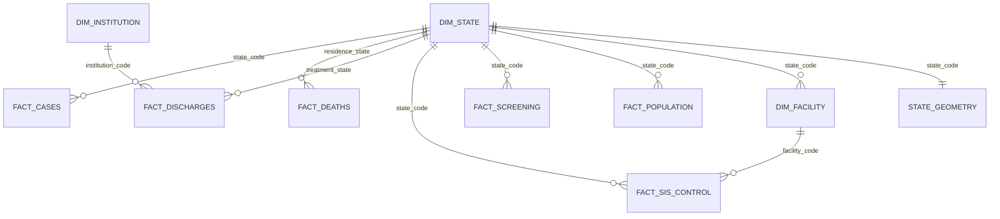

# Data model · Privacy-preserving screening

For the implemented operational vault envelope and public diagrams of both data stores, see [SYSTEM_DIAGRAMS.md](SYSTEM_DIAGRAMS.md) and the [web atlas](https://antimarrulla-tamizaje.netlify.app/architecture#data-model). The star model below is conceptual; the implementation uses files, with no SQL engine or patient-level cross-source joins.

## Separate predictive and analytical data

| Purpose | Data | Location |
|---------|------|----------|
| Predictive model | Individual public survey predictors/label for training and encrypted numerical evaluation | data/cdc_891 |
| Mexican context | Independent official state/year/sex/age/institution aggregates | Other data directories |

The synthetic demo does not use private Mexican patient records. Public source microdata may be processed locally into aggregates; the analytical sources do not follow the same people. Original source filenames/columns remain stable, while code, explanations and presentation schemas use English.

## A. Predictive contract

CDC BRFSS 2015, UCI 891: **253,680 rows ×23 columns**, ID plus target plus 21 predictors; 13.93% positive.

| Role | Source fields | Interpretation |
|------|---------------|----------------|
| Row identifier | ID | Excluded from predictors |
| Target | Diabetes_binary | Source binary reported prediabetes/diabetes label; not future disease |
| Clinical indicators | HighBP, HighChol, CholCheck, BMI, Stroke, HeartDiseaseorAttack | Binary indicators and BMI, recorded as an integer code/value |
| Habits | Smoker, PhysActivity, Fruits, Veggies, HvyAlcoholConsump | Binary |
| Access | AnyHealthcare, NoDocbcCost | Binary |
| Perceived health | GenHlth 1–5, MentHlth/PhysHlth 0–30, DiffWalk | Ordinal/count/binary |
| Demographics | Sex, Age 1–13 | Source-coded categories |

Schema `cdc19-v1` drops Education 1–6 and Income 1–8 from the model inputs (validation ROC-AUC change −0.0006; see [SCHEMA_CDC19.md](SCHEMA_CDC19.md)).

There are no nulls. Over the 19 model features plus label, 60,142 rows repeat; identical categorical responses do not establish duplicate people. 10,865 test profiles (28.55%) also appear in training (24,206 and 4,560 with the earlier 21 features). Deduplicated-training sensitivity is reported, but it does not establish profile-independent splits; grouping identical profiles would be a separate experiment.

Use shared stratified **70/15/15** splits, seed 2026, under artifacts/splits. Fit standardization on training only, then fold it into weights and intercept. Inputs remain original integers. Quantize only model weights/intercept at scale 10^9, exponent zero. The exported model uses class_weight=None. Compare floating/fixed-point/encrypted variants on the exact same sample. Report validation-threshold sensitivity/specificity, AP, calibration, exact integer equality and the separate quantization bound. See [PROJECT.md](PROJECT.md).

### ENSANUT exploratory bridge

The implemented external experiment is a **distinct reduced ten-feature model**, not the 19-feature MVP (`cdc19-v1`). The original design considered reduction or imputation; the committed protocol selected reduction without imputation before evaluation. Microdata remains local. The target differs from the CDC label.

| CDC concept | ENSANUT source | Mapping/limit |
|-------------|----------------|---------------|
| Diagnosed diabetes | a0301 | Yes=1; no=3; pregnancy-only=2 excluded. CDC also includes prediabetes; a0301a would be a separate unrun 2023 variant. |
| HighBP | a0401 | Reported clinician hypertension diagnosis |
| HighChol | a0604 | Reported high cholesterol |
| CholCheck | a0603 | Ever tested; CDC timeframe differs |
| BMI | an01_1/an12_1 weight; an04_1/an15_1 height | Exclude sentinel values such as 222.22/222.2; apply documented plausibility/range rules |
| Stroke | a0502d | Reported stroke |
| Smoker | a1301/a1305 | Current/previous smoking; differs from CDC lifetime-cigarette definition |
| PhysActivity | fa0401/fa0403/fa0405 | Submodule only; excluded from the reduced experiment |
| Sex/Age | h0302/h0303 | Recode to CDC sex/13 age categories |
| Education | h0317a | Approximate CDC 1–6 mapping |
| HeartDiseaseorAttack | a0502a/a0502b | Infarction/angina |
| Other ten predictors | No directly verified comparable source | Excluded, not imputed |

Base adults with valid BMI and yes/no diabetes: 8,628 (2022), 3,089 (2023). After all predictor/weight exclusions, the experiment includes **8,414** and **3,010**. Report weighted metrics using ponde_f and unweighted references. The label is reported diagnosed disease, not future or undiagnosed diabetes. Exact definitions/results are in [ENSANUT_EXPERIMENT.md](ENSANUT_EXPERIMENT.md).

SSA PESO/TALLA, SIS hypertension counts and population age/sex fields offer narrative context, not records to join to CDC individuals. SINAVE new cases and SIS treatment totals are different population measures.

## B. Analytical star model

English conceptual entities below correspond to preserved original field names.

### Dimensions

| Concept | Source | Key and content |
|---------|--------|-----------------|
| State | data/catalogos/entidades.csv | cve_ent, two-digit INEGI 01–32; official/short names, abbreviation, ISO, SINAVE region and IMSS delegations |
| State geometry | data/geo/estados_mx.geojson | cve_ent; 32 Natural Earth polygons simplified to three decimals |
| Facility (catalog not redistributed; see data/README.md) | data/catalogos/clues_202608.csv | clues; 64,450 facilities, August 2026, institution/state/municipality/care level/status/coordinates |
| Institution | Sector descriptor DH catalog | 1 SSA, 2 IMSS, 3 IMSS-Bienestar, 4 ISSSTE, 5 PEMEX, 6 SEMAR, 7 state, 8 private, 9 DIF, 10 municipal, 11 university, 12 SEDENA, 13 Servicios de Salud IMSS-Bienestar, 14 CIJ |
| Time | Source fields | anio, epi_year/epi_week, mes; distinct calendar/epidemiological meanings |

### Facts and grain

| Concept | File | Grain | Years |
|---------|------|-------|-------|
| New cases | sinave/tipo1/products.csv and tipo2/products.csv | State × epidemiological week × sex × diabetes type | 2014–2026 |
| Deaths | historicos/defunciones_diabetes_2017_2024.csv | Registration year × occurrence year × residence state × sex × age group × cause | 2017–2024 |
| All-cause death denominator | historicos/defunciones_todas_causas_2017_2024.csv | Year × state × sex | 2017–2024 |
| Discharges | historicos/egresos_diabetes_2018_2024.csv | Year × treatment state × institution × sex × age × discharge reason × condition | 2018–2024 |
| All-cause discharge denominator | historicos/egresos_todas_causas_2018_2024.csv | Year × state × institution | 2018–2024 |
| SIS control | sis_cronicas/DA_EC_SIS_YEAR.zip | Facility CLUES × month | 2021–2023 |
| IMSS screening | imss_detecciones/deteccion_diabetes.csv | Delegation × year | 2000–2023 |
| Population | conapo/pobproy_quinq1.csv | Municipality × sex × year × five-year age | 1990–2040 |
| Individual detail | defunciones, egresos_ssa, egresos_sector | Source event record | 2024 |

Death fields include anio_registro, anio_ocurrencia, cve_ent_residencia, sexo, grupo_edad, causa_cie3 and defunciones. Discharge fields include anio, cve_ent_atencion, institucion_dh, sexo, grupo_edad, motivo_egreso, afeccion_cie3, egresos and dias_estancia_total. SIS uses CLUES/state/year/month and ADM/HBA fields. These are documented source identifiers, not untranslated code variables.

### State/year mart

`data/marts/cascada_entidad_anio.csv`: 32 states ×2017–2024 = **256 rows**.

| Original column | English definition |
|-----------------|--------------------|
| poblacion, poblacion_20mas | CONAPO mid-year total and age-20+ population |
| casos_nuevos_t1, casos_nuevos_t2 | Sum of weekly SINAVE case notifications |
| detecciones_imss | IMSS diabetes screening encounters, 2017–2023 |
| sis_en_tratamiento, sis_controlados | Monthly average treatment/control counts, 2021–2023 |
| sis_pruebas_hba1c, sis_pie_diabetico | Annual HbA1c and foot-related count totals |
| egresos, muertes_hospital | Sector diabetes discharges and discharge deaths, 2018–2024 |
| defunciones | E10–E14 deaths occurring and registered in the same year, by residence |
| tasa_casos_100k, tasa_defunciones_100k | Rates per 100,000 total residents |
| defunciones_por_100_casos | Exploratory deaths/notified-cases ratio, not case fatality |
| pct_controlados_sis | Controlled/treatment monthly-average ratio |

| Year | New cases | IMSS screening | SIS treatment | SIS controlled | Discharges | Deaths |
|------|----------:|---------------:|--------------:|---------------:|-----------:|-------:|
| 2021 | 397,842 | 10,258,345 | 454,622 | 175,764 (38.7%) | 89,480 | 136,899 |
| 2022 | 474,154 | 13,146,251 | 461,668 | 167,387 (36.3%) | 112,828 | 111,871 |
| 2023 | 502,782 | 15,801,491 | 493,504 | 179,453 (36.4%) | 122,560 | 107,008 |
| 2024 | 497,987 | — | — | — | 120,385 | 109,603 |

The 36.4% control figure describes reporting SIS units; Chihuahua is 24.2% in that source. It is not a national all-institution control estimate.

## Harmonization rules

| Topic | Rule |
|-------|------|
| State | Two-digit INEGI cve_ent; map SINAVE/IMSS names through entidades.csv. Aggregate split IMSS delegations to the state. |
| Geography | Deaths use residence; discharges use treatment state CEDOCVE; SINAVE uses the notifying unit. Disclose differences. |
| Sex | EDR/discharges: 1 male, 2 female, 9/0 unspecified. SINAVE source uses hombres/mujeres/general. Prefer general for T1 because its sex split was imputed. |
| Age | Harmonized source bands <20, 20–59, 60+. Retain DGIS source groups: under one, 1–4, 5–14, 15–44, 45–64, 65+. |
| Diabetes | ICD-10 E10–E14. Keep O24 separately and exclude it from the pitch total. |
| Death year | Mart requires occurrence year=registration year; the registered-year total includes earlier deaths. |
| SINAVE time | Epidemiological year/week can include week 53. |
| Population | CONAPO year-specific denominators for rates. SINAVE exposure is fixed Census 2020 and is an approximation. |

## Lineage and open items

CDC → shared splits → logistic model → encrypted protocol. SINAVE/EDR/discharges/SIS/IMSS/CONAPO and state/facility catalogs → state/year mart → impact slide/map. Natural Earth supplies geometry. The English presentation JSON uses English keys while source CSVs remain byte-stable.

ENSANUT downloads/checks are complete locally; redistribution review remains open. SINAVE age-specific weekly data is unavailable in the supplied series; annual morbidity tables would be another source. The recorded preparation did not include published 2025 deaths. See [DATA_SOURCES.md](DATA_SOURCES.md) for acquisition and source-specific limits.
