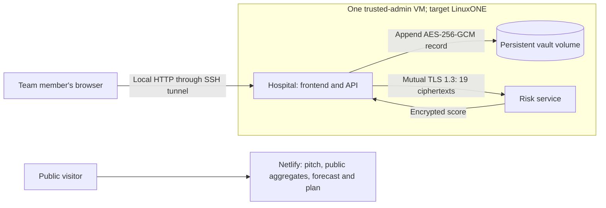

# Frontend, API and storage placement

## Decision

The interactive screening frontend lives in the **Hospital container**, served by the existing hospital HTTP process alongside its API. The hospital and risk-service containers share the approved LinuxONE demo VM. Actual LinuxONE execution remains pending evidence; the same layout has been verified locally.

The public project site stays on **Netlify with its badge**. It serves the pitch, documentation links, public aggregate map, static forecast dashboard and delivery plan. It is separate from the interactive hospital application.

This resolves the captain-supplied October 17 team discussion: Carlos proposed hospital-side storage, Yazmin asked where the frontend should live, and Álvaro confirmed that hosting it there is feasible. These messages establish the team's direction, not evidence that the VM deployment is complete.

| Component | Residence and entry point | Owner |
|-----------|---------------------------|-------|
| Public project site and forecast | Netlify; `site/` | Javier |
| Interactive synthetic screening form | Hospital container, `GET /`; source `src/screening/ui/index.html` | Yazmin; Javier integrates |
| Hospital API, input validation, encryption and decryption | Same hospital process and origin: `/api/state`, `/api/synthetic`, `/api/evaluate` | Álvaro; Carlos reviews numerical behavior |
| Saved screening records | Hospital Docker volume `vault`, at `/var/lib/screening/vault.jsonl` inside the container | Álvaro |
| Vault encryption key and hospital TLS credentials | External secret directory, mounted into Hospital; default host directory `~/.screening` | Álvaro |
| Paillier private key | Hospital process memory; never mounted into the risk service | Álvaro and Carlos |
| Encrypted model evaluation | Risk-service container, internal `https://service:8443/v2/evaluate` | Carlos |
| Public training/benchmark data | Development/training environment; excluded from the app image | Yazmin and Carlos |

The risk-service container receives ciphertexts, evaluates the public fixed-point model and returns an encrypted score. It has neither the hospital vault nor its key. The shared host administrator remains inside the trust boundary. Demo inputs are synthetic.

## Request and storage flow



The browser submits the 21 synthetic values to its own Hospital origin. Hospital validates and encrypts them, calls the risk service, decrypts the returned score, saves an encrypted vault record and returns the result for display. Plaintext input and result are intentionally visible within the Hospital/browser boundary; the remote risk service sees ciphertexts.

The existing persistence layer is an **encrypted append-only JSONL vault**, not a relational database. Each successful evaluation writes a new record containing its ID, synthetic input, profile, result and timestamp. The current UI does not edit historical rows or update training datasets/model weights. A database administration interface or SQL migration is outside this deployment decision.

The named Docker volume survives container recreation and ordinary `make demo-down`. Preserve the matching external vault key when moving or restoring storage. Do not use `docker compose down -v` for a deployment whose saved records must be retained. Paillier keys are generated in hospital process memory; retained vault records use the separate persistent AES key.

## Team access and deployment

Use the same reviewed English release commit for both containers. Run [LINUXONE.md](LINUXONE.md), then access the hospital through SSH from each laptop:

```bash
ssh -N -o ExitOnForwardFailure=yes -L 18080:127.0.0.1:8080 USER@VM_IP
```

Open `http://127.0.0.1:18080` on that laptop. Port 18080 is local; the example assumes the default VM-side Compose port 8080. If `SCREENING_UI_PORT` changes on the VM, change the tunnel's destination port to match.

Compose already publishes Hospital only at VM loopback and leaves the risk-service port internal. The browser's relative `/api/...` requests go to Hospital, so this layout needs no cross-origin API setup or separate frontend server. Frontend edits require rebuilding/recreating the Hospital image/container with `make demo-docker`; copying HTML into Netlify does not update the hospital application.

The current hospital endpoint has no application login. Keep its existing loopback/SSH access for the team demo. A public interactive prototype remains optional and unimplemented; it would need a separate access-control and HTTPS deployment decision. The public Netlify URL does not give access to the Hospital API or vault.

## Immediate handoff

- **Yazmin:** maintain the English form at `src/screening/ui/index.html` on the combined release. The old `src/tamizaje/` branch was incorporated and retired. Prepare English narration and synthetic demo footage next.
- **Álvaro:** deploy Hospital and its persistent volume/key on the approved VM; confirm the SSH tunnel and capture actual provider/architecture/container evidence.
- **Carlos:** deploy the matching risk-service version; run verification and both final measurement modes with Álvaro. A second host is optional.
- **Javier:** coordinate release review and the recorded demo; maintain the Netlify presentation/plan and confirm Hack2Skill leader access. Do not block video preparation on a public prototype URL.

A hosting decision does not close US-2.5/2.6, US-6.2/6.3 or US-7.8. Close VM stories only with real execution evidence. US-7.8 remains open until an optional public interactive URL actually exists.
