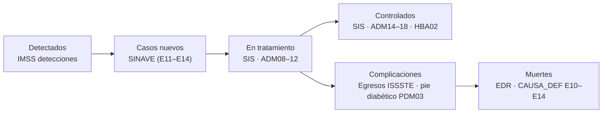

# 📊 Fuentes de datos

El **CDC** entrena el modelo. Las fuentes mexicanas (**SINAVE**, **EDR**, **SIS crónicas**, **IMSS detecciones**, **egresos ISSSTE** y **CONAPO**) dan el contexto de impacto y arman la [cascada de atención de la diabetes](#5-la-cascada-de-atención-de-la-diabetes).

> Ningún dataset se sube al repo. Cómo descargarlos: [data/README.md](../data/README.md).

---

## 0. Descarga automatizable: rutas directas

Probadas con `curl` el 17 de octubre de 2026. Todas responden con el ZIP/CSV real (no HTML).

| Fuente | Qué trae | URL directa | Tamaño |
|--------|----------|-------------|--------|
| **DGIS · Defunciones** | Mortalidad individual (mismas variables que la EDR) · **2017–2024** | `http://www.dgis.salud.gob.mx/descargas/datosabiertos/defunciones/registro/DEFUN_{año}.zip` | 31 MB (2024) |
| **DGIS · Egresos hospitalarios SSA** | Hospitalizaciones en unidades de la Secretaría de Salud · **2019–2026** | `http://www.dgis.salud.gob.mx/descargas/datosabiertos/egresos/ssa_egresos_{año}.zip` | 111 MB (2024) |
| **DGIS · Urgencias** | Atenciones de urgencias SSA · 2019–2026 | `http://www.dgis.salud.gob.mx/descargas/datosabiertos/urgencias/Urgencias_{año}.zip` | — |
| **DGIS · Enfermedades crónicas (SIS)** | Control de diabetes por unidad médica y mes · 2010–2023 | `http://www.dgis.salud.gob.mx/descargas/datosabiertos/serviciosOtorgados/Enfermedades_cronicas_no_transmisibles_en_el_adulto_y_en_el_anciano/DA_EC_SIS_{año}.zip` | ~5 MB |
| **DGIS · Descriptor SIS** | Diccionario de variables (hoja `Descriptor-ECRON`) | `http://www.dgis.salud.gob.mx/descargas/datosabiertos/serviciosOtorgados/Descriptor-Datos_Servicios_2010_2023.xlsx` | 209 KB |
| **INEGI · EDR microdatos** | Mortalidad individual (DBF) · 2020–2024 por año | `https://www.inegi.org.mx/contenidos/programas/edr/microdatos/defunciones/{año}/defunciones_base_datos_{año}_dbf.zip` | — |
| **INEGI · EDR histórico** | DBF por quinquenio 1990–2019 | `https://www.inegi.org.mx/contenidos/programas/edr/microdatos/defunciones/datos/defunciones_generales_base_datos_{1990_1994…2015_2019}_dbf.zip` | — |
| **IMSS · Detecciones de diabetes** | Tamizajes por delegación · 2000–2023 | `https://www.datos.gob.mx/dataset/0ad05edd-1c6b-469e-b52b-a58234b29e65/resource/25261f00-c346-446d-84a4-943691569af9/download/deteccion_diabetes.csv` | 37 KB |
| **UCI · CDC 891** | Entrenamiento del modelo | `ucimlrepo.fetch_ucirepo(id=891)` | — |

Las URLs de la DGIS aceptan un `?v=` de versión que se puede omitir. Índice de todas sus bases: http://www.dgis.salud.gob.mx/contenidos/basesdedatos/Datos_Abiertos_gobmx.html

**Solo navegador** (bloquean scripts): todo lo que vive en `repodatos.atdt.gob.mx` (CSV de datos.gob.mx de defunciones, crónicas, egresos ISSSTE y CONAPO). Para defunciones y crónicas hay equivalente en la DGIS; para egresos del ISSSTE y CONAPO, bajar a mano.

---

## 1. CDC Diabetes Health Indicators (entrenamiento)

| Campo | Valor |
|-------|-------|
| Fuente | UCI Machine Learning Repository, ID 891 · CDC BRFSS 2015 |
| Link | https://archive.ics.uci.edu/dataset/891/cdc+diabetes+health+indicators |
| Tamaño | 253,680 registros · 21 indicadores |
| Variable objetivo | `Diabetes_binary` (0 = sin diabetes; 1 = prediabetes o diabetes) · 13.9% positivos |
| Ejemplos de indicadores | IMC, presión alta, colesterol alto, actividad física, tabaquismo, edad, sexo, ingreso, acceso a servicios de salud |
| Acceso | `pip install ucimlrepo` → `fetch_ucirepo(id=891)` |
| Licencia | CC BY 4.0 |

## 2. Estadísticas de Defunciones Registradas, EDR (mortalidad · INEGI)

Base anual de registros individuales de defunción, generada a partir del certificado de defunción (Registro Civil y Servicios Médicos Forenses). La causa básica se codifica con CIE-10. La diabetes mellitus es consistentemente una de las dos principales causas de muerte del país.

| Campo | Valor |
|-------|-------|
| Programa | https://www.inegi.org.mx/programas/edr/ (secciones *Microdatos* y *Datos abiertos*) |
| Microdatos (DBF) por año | `https://www.inegi.org.mx/contenidos/programas/edr/microdatos/defunciones/{2020…2024}/defunciones_base_datos_{año}_dbf.zip` |
| Microdatos históricos | `…/microdatos/defunciones/datos/defunciones_generales_base_datos_{1990_1994 … 2015_2019}_dbf.zip` |
| Datos abiertos (CSV) | `…/edr/datosabiertos/conjunto_de_datos_defunciones_registradas_2022_csv.zip` |
| Diccionario 2024 | https://www.inegi.org.mx/rnm/index.php/catalog/1140/data-dictionary |
| Nota de microdatos | https://www.inegi.org.mx/contenidos/programas/edr/microdatos/defunciones_registradas_notas_microdatos.pdf |
| Licencia | Términos de libre uso de la información del INEGI (citar la fuente) |

> ✅ **Los ZIP de microdatos de INEGI sí se descargan con `curl`** (probado el 17 oct 2026). Lo que no funciona es *scrapear* la página del programa, porque arma los enlaces con JavaScript: usar las URLs directas de esta tabla. Para leer DBF en Python: `dbfread` o `geopandas`/`pyogrio`.
>
> INEGI no tiene API para microdatos. Su [API del Banco de Indicadores](https://www.inegi.org.mx/servicios/api_indicadores.html) (token gratuito) solo da indicadores agregados.

> 💡 **Alternativa en CSV:** la Secretaría de Salud publica la misma base, **con las mismas columnas más fechas armadas**, en datos.gob.mx para 1998–2023 (ver [sección 4.1](#41-defunciones-registradas-secretaría-de-salud)). Para 2024 solo está el DBF de INEGI.

### Variables de `DEFUN24` (74 en total)

| Bloque | Variables |
|--------|-----------|
| Causa | `CAUSA_DEF` (CIE-10 detallada: **E10–E14** diabetes, **O24** diabetes en el embarazo), `LISTA_MEX`, `GR_LISMEX`, `CAPITULO`, `GRUPO`, `LISTA1`, `COD_ADICIO` |
| Persona | `SEXO`, `EDAD`, `EDAD_AGRU`, `ESCOLARIDA`, `OCUPACION`, `COND_ACT`, `EDO_CIVIL`, `CONINDIG`, `LENGUA`, `CVE_LENGUA`, `AFROMEX`, `NACIONALID`, `NACESP_CVE`, `ENT_NAC` |
| Salud | `DERECHOHAB`, `ASIST_MEDI`, `SITIO_OCUR`, `NECROPSIA`, `USONECROPS`, `COND_CERT`, `CIRUGIA`, `ENCEFALICA`, `DONADOR` |
| Lugar | `ENT_/MUN_/LOC_/TLOC_` × `RESID` (residencia), `OCURR` (ocurrencia), `REGIS` (registro); `ENT_/MUN_/LOC_OCULES` (lesión); `AREA_UR`; `DIS_RE_OAX` |
| Fechas | `DIA_/MES_/ANIO_` × `OCUR(R)`, `REGIS`, `NACIM`, `CERT`; `HORAS`, `MINUTOS` |
| Violencia y maternas | `TIPO_DEFUN`, `NATVIOLE`, `LUGAR_OCUR`, `OCURR_TRAB`, `PAR_AGRE`, `VIO_FAMI`, `EMBARAZO`, `REL_EMBA`, `COMPLICARO`, `MATERNAS`, `RAZON_M` |
| Perinatales | `SEM_GEST`, `GRAMOS` |

### Catálogos clave

| Variable | Códigos |
|----------|---------|
| `SEXO` | 1 Hombre · 2 Mujer · 9 No especificado |
| `ESCOLARIDA` | 1 Sin escolaridad · 2 Preescolar · 3 Primaria incompleta · 4 Primaria completa · 5 Secundaria incompleta · 6 Secundaria completa · 7 Bachillerato incompleto · 8 Bachillerato completo · 9 Profesional · 10 Posgrado · 88 No aplica (<3 años) · 99 No especificada |
| `EDO_CIVIL` | 1 Soltero · 2 Divorciado · 3 Viudo · 4 Unión libre · 5 Casado · 6 Separado · 8 No aplica (<12 años) · 9 No especificado |
| `DERECHOHAB` | 1 Ninguna · 2 IMSS · 3 ISSSTE · 4 PEMEX · 5 SEDENA · 6 SEMAR · 7 Equivalente a Seguro Popular · 8 Otra · 9 IMSS-Bienestar · 10 ISSFAM · 12 OPD IMSS-Bienestar · 99 No especificada |
| `SITIO_OCUR` | 1 SSA · 2 IMSS-Bienestar · 3 IMSS · 4 ISSSTE · 5 PEMEX · 6 SEDENA · 7 SEMAR · 8 Otra pública · 9 Privada · 10 Vía pública · 11 Hogar · 12 Otro · 13 OPD IMSS-Bienestar · 99 No especificado |
| `ASIST_MEDI` | 1 Con asistencia · 2 Sin asistencia · 9 No especificado |
| `AREA_UR` | 1 Urbana (≥2,500 hab.) · 2 Rural · 9 No especificada |
| `COND_ACT` | 1 Sí trabajó · 2 No trabajó · 8 No aplica (<5 años) · 9 No especificado |
| `TIPO_DEFUN` | 4 Enfermedad (muerte natural); 1–3 y 5 accidentes y violencias |

> `EDAD` no trae catálogo en el diccionario. Convención INEGI (verificar en el descriptor del año): el primer dígito indica la unidad (4xxx = años).

## 3. SINAVE · incidencia (vigilancia convencional SUIVE-1)

Notificación **semanal y agregada** de casos nuevos por unidad médica. No es base individual.

| Campo | Valor |
|-------|-------|
| Formato | SUIVE-1 · Informe semanal de casos nuevos de enfermedades |
| Manual | https://epidemiologia.salud.gob.mx/gobmx/salud/documentos/manuales/32_ManualSuive.pdf |
| Publicación anual | Anuarios de Morbilidad 1984–2025: https://www.gob.mx/salud/acciones-y-programas/anuarios-de-morbilidad-1984-a-2025 (tablas PDF por entidad, institución, enfermedad, edad y mes) |
| Semanal | Boletín Epidemiológico: https://www.gob.mx/salud/acciones-y-programas/direccion-general-de-epidemiologia-boletin-epidemiologico |

### Variables del SUIVE-1

| Bloque | Variables |
|--------|-----------|
| Unidad notificante | CLUES · municipio (clave INEGI) · jurisdicción sanitaria · entidad (clave INEGI) · institución |
| Tiempo | Semana epidemiológica · fecha de inicio · fecha de término |
| Diagnóstico | **E10** Diabetes tipo 1 · **E11–E14** Diabetes tipo 2 · **O24.4** Diabetes en el embarazo |
| Casos nuevos por sexo y grupo de edad | <1 · 1-4 · 5-9 · 10-14 · 15-19 · 20-24 · **25-44** · 45-49 · 50-59 · 60-64 · 65+ · Ign. |
| Derivadas (anuario) | Tasa de incidencia por 100,000 habitantes · fuente de notificación · principales causas |

## 4. Fuentes adicionales en datos.gob.mx

Revisadas el 17 de octubre de 2026 a sugerencia de Álvaro. Todas tienen licencia **CC BY 4.0** (citar la fuente).

> ⚠️ Los archivos en `repodatos.atdt.gob.mx` bloquean `curl` ("Access Denied") y solo bajan desde el navegador. **Para automatizar, usar las rutas equivalentes de la DGIS** ([sección 0](#0-descarga-automatizable-rutas-directas)), que sí aceptan `curl`. La API del catálogo de datos.gob.mx sí responde para metadatos: `https://www.datos.gob.mx/api/3/action/package_show?id=<conjunto>`.

| # | Conjunto | Institución | Cobertura | Nivel | Para qué nos sirve |
|---|----------|-------------|-----------|-------|--------------------|
| 4.1 | [Registro de defunciones](https://www.datos.gob.mx/dataset/registro_defunciones) | Secretaría de Salud | 1998–2023 · CSV (~206 MB en 2023) | Individual | Mortalidad por diabetes en CSV directo; mismas variables que la EDR |
| 4.2 | [Registro de enfermedades crónicas en adultos](https://www.datos.gob.mx/dataset/registro_enfermedades_cronicas_adultos) | Secretaría de Salud (SIS/DGIS) | 2010–2023 · CSV (~53 MB en 2023) | Unidad médica × mes | **Control** de la diabetes: en tratamiento, controlados, HbA1c, pie diabético |
| 4.3 | [Detección de padecimientos por delegación](https://www.datos.gob.mx/dataset/deteccion_padecimientos_delegacion) | IMSS | 2000–2023 · CSV (37 KB) | Delegación × año | **Tamizaje**: detecciones de diabetes realizadas |
| 4.4 | [Datos de egresos hospitalarios](https://www.datos.gob.mx/dataset/datos_egresos_hospitalarios) | ISSSTE | 2020 y 2024 · CSV (~58 MB en 2024) | Individual | Hospitalizaciones por diabetes (complicaciones) |
| 4.5 | [Proyecciones de población](https://www.datos.gob.mx/dataset/proyecciones-de-poblacion) · [Índices de marginación](https://www.datos.gob.mx/dataset/indices_marginacion) | CONAPO | 1950–2070 · 2010–2020 | Entidad / municipio | Denominadores para tasas · determinantes sociales |

### 4.1 Defunciones registradas (Secretaría de Salud)

- URL por año: `https://repodatos.atdt.gob.mx/all_data/secretaria_salud/6fecbbb3-afd9-44a1-8665-679a80ce4a15/defunciones_registradas_{año}.csv`
- Columnas: las 74 de la EDR (sección 2) **más** `FECHA_OCURR`, `FECHA_NACIM`, `FECHA_REGIS`, `FECHA_CERT`, `fn_LISTA_MEX`, `fn_GR_LISMEX`.
- Filtro de diabetes: `CAUSA_DEF` empieza con `E10`–`E14` (y `O24` en el embarazo).
- **Ruta automatizable:** el mismo registro está en la DGIS como `DEFUN_{año}.zip` (2017–2024, incluye 2024).

### 4.2 Enfermedades crónicas en adultos (SIS)

- URL por año: `https://repodatos.atdt.gob.mx/s_salud/enf_cronicas_adultos/DA_EC_SIS_{año}.csv`
- También en la DGIS como ZIP, con el **descriptor de variables**: http://www.dgis.salud.gob.mx/contenidos/basesdedatos/da_sis_gobmx.html (`Descriptor-Datos_Servicios_2010_2023.xlsx`, hoja `Descriptor-ECRON`).
- Llaves: `CLAVE_ENTIDAD`, `ENTIDAD`, `CLAVE_MUNICIPIO`, `MUNICIPIO`, `CLUES`, `NOMBRE_CLUES`, `MES`, `ANIO`, `FECHA`.
- Los valores vienen como `NULL` cuando no hay registro.
- **Ruta automatizable:** `DA_EC_SIS_{año}.zip` en la DGIS (ver sección 0).

| Prefijo | Apartado | Variables (sufijo = sexo y edad) |
|---------|----------|----------------------------------|
| `ADM` | Control y seguimiento de **diabetes mellitus** | `02/03/05/06` ingresos a tratamiento · `08/09/11/12` en tratamiento · `14/15/17/18` **controlados** (M 20-59, M 60+, H 20-59, H 60+) · `20–22` en tratamiento con insulina · `23` controlados con insulina |
| `AHA` | Hipertensión arterial | Mismo esquema que `ADM` |
| `AOB` | Obesidad | Mismo esquema |
| `ADL` | Dislipidemias | Mismo esquema |
| `AEC` | Síndrome metabólico | Mismo esquema |
| `HBA` | **Hemoglobina glucosilada (HbA1c)** en pacientes con DM | `01` número de pruebas · `02` controlados con HbA1c · `03` cobertura |
| `PDM` | Revisión de pies en DM | `02` revisiones · `03` con pie diabético |
| `PMA` | Microalbuminuria | `01` pruebas en DM · `02` pruebas en hipertensión |
| `FRS` | Factor de riesgo: sobrepeso | `01` M 20-59 · `02` M 60+ · `03` H 20-59 · `04` H 60+ |
| `RUN` | Referencia a UNEME-EC | `01` |

> Cubre las unidades que reportan al SIS (principalmente Secretaría de Salud / IMSS-Bienestar), no a todo el sistema de salud.

### 4.3 Detecciones de diabetes (IMSS)

- URL: `https://www.datos.gob.mx/dataset/0ad05edd-1c6b-469e-b52b-a58234b29e65/resource/25261f00-c346-446d-84a4-943691569af9/download/deteccion_diabetes.csv`
- Columnas: `delegacion`, `ano`, `detecciones`, `fecha`, `fn_ano`.
- Ojo: `ano` trae notas pegadas (`2004*`, `2008 (1)`, `2012 (2)`); limpiar antes de convertir a número. Los nombres de delegación traen espacios al inicio.
- El mismo conjunto trae hipertensión, cáncer, nutrición y otros padecimientos.

### 4.4 Egresos hospitalarios (ISSSTE)

- URL 2024: `https://repodatos.atdt.gob.mx/api_update/issste/datos_egresos_hospitalarios/egresos_hospitalarios_issste2024.csv`
- Columnas: `entidad`, `unidad`, `clues`, `edad_anios`, `sexo`, `servicio_troncal`, `tipo_derechohabiente`, `fecha_ingreso`, `fecha_egreso`, `diagnostico_principal_cie10`, `descripcion_cie_010`.
- Filtro: `diagnostico_principal_cie10` empieza con `E10`–`E14`. La estancia sale de `fecha_egreso − fecha_ingreso`.
- **Más grande y automatizable:** los egresos de la Secretaría de Salud (`ssa_egresos_{año}.zip`, 2019–2026) están en la DGIS; revisar su descriptor antes de usarlos.

### Fuentes revisadas que no nos sirven

- **data.buengobierno.gob.mx** (Secretaría Anticorrupción y Buen Gobierno): transparencia, programas del Bienestar, presupuesto (PEF) y corrupción. No trae datos clínicos ni epidemiológicos de diabetes. A lo mucho, presupuesto en salud para la narrativa.
- En datos.gob.mx **no hay** ENSANUT, glucosa ni COVID con comorbilidades: para entrenar seguimos con el CDC.

---

## 5. La cascada de atención de la diabetes

La idea para el slide de impacto: seguir a la diabetes en México **de la detección a la muerte**, por entidad, con fuentes oficiales.

| Escalón | Fuente | Variable | Nivel |
|---------|--------|----------|-------|
| 1. Detectados (tamizaje) | IMSS detecciones | `detecciones` | Delegación × año |
| 2. Casos nuevos | SINAVE (SUIVE-1) | Casos E11–E14 | Entidad × semana |
| 3. En tratamiento | SIS crónicas | `ADM08`+`ADM09`+`ADM11`+`ADM12` | CLUES × mes |
| 4. Controlados | SIS crónicas | `ADM14`+`ADM15`+`ADM17`+`ADM18`, `HBA02` | CLUES × mes |
| 5. Complicaciones | Egresos ISSSTE · SIS | Egresos E10–E14 · `PDM03` | Individual · CLUES × mes |
| 6. Muertes | EDR / Defunciones SSA | `CAUSA_DEF` E10–E14 | Individual |
| Denominador | CONAPO | Población 20+ por entidad y sexo | Entidad × año |

**Por qué importa para el pitch:** cada escalón donde se pierde gente es un lugar donde el tamizaje temprano ayuda. Y el mensaje cierra solo: **para detectar antes hacen falta datos que hoy nadie comparte**, justo lo que Tamizaje a ciegas resuelve.

**Cuidado al comparar escalones:** cada fuente cubre a una población distinta (IMSS, Secretaría de Salud, ISSSTE, todo el país). La cascada es **ilustrativa por entidad**, no un seguimiento de las mismas personas. Decirlo así en el pitch.

---

## 6. Cómo cruzar SINAVE (incidencia) con EDR (mortalidad)

| Llave | SINAVE | EDR | Nota |
|-------|--------|-----|------|
| Entidad / municipio | Clave INEGI de la unidad notificante | `ENT_RESID`, `MUN_RESID` | ⚠️ SINAVE ubica por **unidad**; EDR por **residencia**. Para tasas, usar residencia |
| Tiempo | Semana epidemiológica | `ANIO_OCUR`, `MES_OCURR`, `DIA_OCURR` | Convertir la fecha de defunción a semana epidemiológica |
| Sexo | Hombre / mujer | `SEXO` | Directo |
| Edad | 12 grupos SUIVE | `EDAD` | Recodificar `EDAD` a grupos SUIVE; `EDAD_AGRU` es quinquenal y no tiene 25-44 |
| Diagnóstico | E10, E11–E14, O24.4 | `CAUSA_DEF` | Filtrar `CAUSA_DEF` por E10–E14 y O24 |
| Institución | Fuente de notificación | `DERECHOHAB` o `SITIO_OCUR` | Elegir una; no son equivalentes |

**Lo que solo da la EDR:** escolaridad, ocupación, estado civil, afiliación, autoadscripción indígena y área urbana o rural. Sirve para hablar de **determinantes sociales** de la mortalidad por diabetes, que la incidencia del SINAVE no permite.

**Denominadores para tasas:** proyecciones de población de CONAPO por entidad, sexo y edad.

## 6.1 Primeros conteos con los microdatos (17 oct 2026)

Archivos: `DEFUN_2024.zip` y `ssa_egresos_2024.zip` de la DGIS, en `data/raw/` (no versionados).

**Defunciones registradas 2024** (819,672 registros)

| Indicador | Valor |
|-----------|------:|
| Diabetes (E10–E14) | 112,577 (13.7%) |
| E11 tipo 2 · E14 no especificada · E10 tipo 1 | 85,395 · 22,537 · 4,323 |
| Hombres · mujeres | 56,131 · 56,442 |
| Top residencia | Edo. de México 17,155 · Veracruz 10,585 · CDMX 8,565 · Puebla 7,065 |
| Chihuahua | 2,768 |

**Egresos hospitalarios SSA 2024** (2,649,236 egresos, archivo `Egresos.txt` separado por `|`, latin-1)

| Indicador | Valor |
|-----------|------:|
| Afección principal diabetes (`AFECPRIN` E10–E14) | 62,771 (2.4%) |
| Con amputación de miembro inferior (CIE-9 84.1x) | 11,550 (18.4%) |
| Con hemodiálisis (CIE-9 39.95) | 1,719 (2.7%) |
| Murieron en el hospital (`MOTEGRE` = 5) | 2,976 (4.7%) |
| Estancia media | 5.1 días |
| Top residencia | Edo. de México 6,697 · Veracruz 5,491 · Guanajuato 4,215 · CDMX 3,891 |
| Chihuahua | 1,332 |

Notas: los egresos cubren solo unidades de la Secretaría de Salud e IMSS-Bienestar (la DGIS también publica `sectorial_egresos_{año}.zip` con todas las instituciones). Descriptor: `ssa_Descriptores_Bases_de_Datos_EGRESOS_2023_2025.xlsx`; los catálogos van en su segunda hoja.

---

## 7. Cifras de contexto usadas en el pitch

| Cifra | Fuente |
|-------|--------|
| 18.3% de adultos con diabetes; 12.6% diagnosticada y 5.8% sin diagnóstico | ENSANUT 2022, Basto-Abreu et al., *Salud Pública de México* 2023;65(supl 1):S163-S168 |
| 112,577 defunciones por diabetes registradas en 2024 (13.7% del total; 109,698 ocurridas en 2024) | Defunciones registradas 2024, microdatos DGIS/INEGI (conteo propio de `causa_def` E10–E14) |
| 62,771 egresos con diabetes como afección principal en unidades SSA / IMSS-Bienestar, 2024 | Egresos hospitalarios SSA 2024, DGIS (conteo propio) |
| 11,550 (18.4%) de esos egresos con amputación de miembro inferior; 1,719 (2.7%) con hemodiálisis | Egresos hospitalarios SSA 2024, DGIS (conteo propio) (CIE-9 84.1x y 39.95 en `Procedimientos.txt`) |
| 2,976 (4.7%) murieron en el hospital; estancia media 5.1 días | Egresos hospitalarios SSA 2024, DGIS (conteo propio) (`MOTEGRE` = 5) |

> El boletín preliminar de INEGI publicó 112,641 defunciones por diabetes en 2024; los microdatos dan 112,577. Usamos la cifra de los microdatos porque la podemos reproducir.
