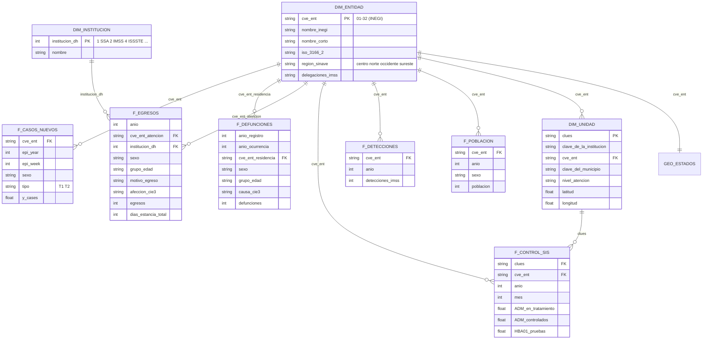
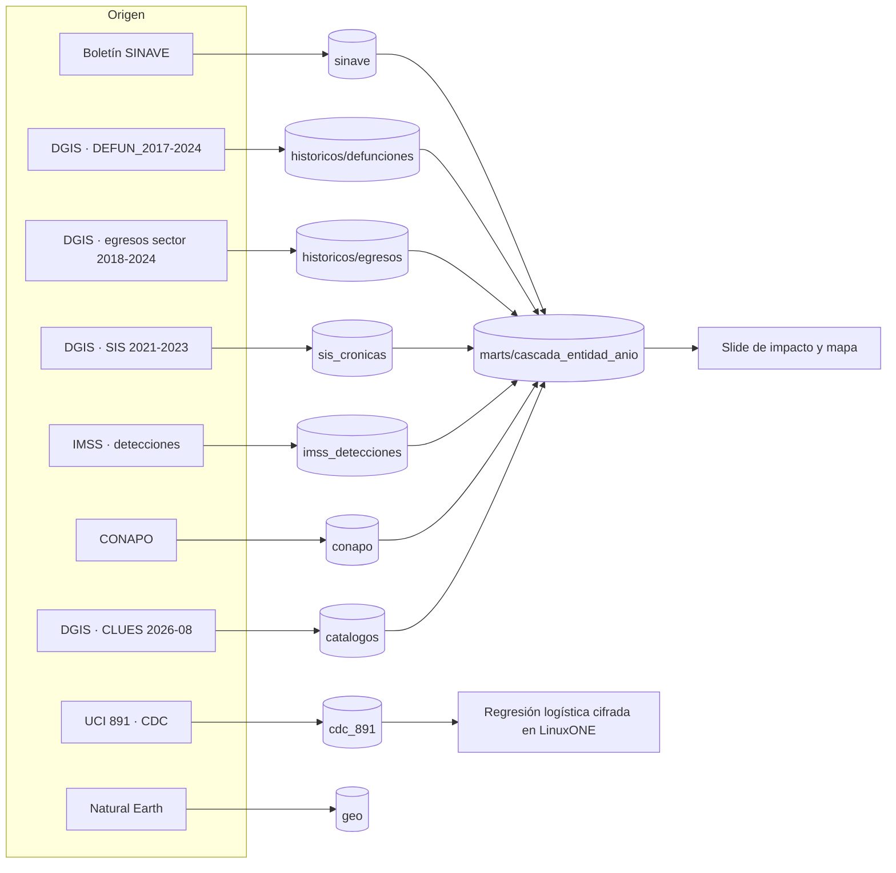

# 🧱 Modelo de datos · Tamizaje a ciegas

Dos mundos que no se mezclan:

| Mundo | Para qué | Datos | Dónde |
|-------|----------|-------|-------|
| **A. Modelo predictivo** | Entrenar y evaluar la regresión logística que corre **cifrada** en LinuxONE | Registros individuales con factores de riesgo y etiqueta | `data/cdc_891/` |
| **B. Modelo analítico** | Contar la historia de México: cascada de atención, brecha de detección, mapas | Agregados oficiales por entidad, año, sexo, edad e institución | Resto de `data/` |

> El mundo A nunca usa datos de pacientes mexicanos reales: en la demo, los "pacientes" son sintéticos y llegan **cifrados**. El mundo B solo usa agregados públicos.

---

## A. Modelo predictivo

**Dataset:** `data/cdc_891/cdc_diabetes_891.csv` · 253,680 registros × 23 columnas · BRFSS 2015 (CDC) · 13.93% positivos.

| Rol | Columna | Tipo | Nota |
|-----|---------|------|------|
| Llave | `ID` | entero | No es variable del modelo |
| **Objetivo** | `Diabetes_binary` | 0/1 | 1 = prediabetes o diabetes |
| Clínicas | `HighBP`, `HighChol`, `CholCheck`, `BMI`, `Stroke`, `HeartDiseaseorAttack` | 0/1 · continua | `BMI` es la única continua clínica |
| Hábitos | `Smoker`, `PhysActivity`, `Fruits`, `Veggies`, `HvyAlcoholConsump` | 0/1 | |
| Acceso | `AnyHealthcare`, `NoDocbcCost` | 0/1 | |
| Salud percibida | `GenHlth` (1–5), `MentHlth` (0–30), `PhysHlth` (0–30), `DiffWalk` | ordinal · conteo | |
| Demografía | `Sex`, `Age` (13 grupos), `Education` (1–6), `Income` (1–8) | categórica ordinal | |

**Preparación para el cifrado (Paillier):**
1. Escalar cada variable a un rango fijo y codificar pesos y variables en **punto fijo** (enteros).
2. Entrenar la regresión logística en claro con datos públicos; guardar `w` y `b`.
3. En inferencia, el hospital cifra el vector `x` (21 valores); el servidor calcula `Enc(w·x + b)`.
4. Particiones: 70 / 15 / 15 estratificadas por `Diabetes_binary`; `class_weight="balanced"` por el desbalance.
5. Métricas: AUC, AUC-PR, recall y F1 en claro, y **AUC cifrado vs. en claro**.

**Validación externa con México: ENSANUT 2022/2023** (historia US-3.5, prioridad Plus)

El modelo se entrena con el CDC y se **evalúa** en adultos mexicanos de ENSANUT con las variables equivalentes. Los microdatos no se suben al repo (ver [FUENTES_DATOS.md §8](FUENTES_DATOS.md#8-ensanut-2022-y-2023-insp--validación-externa-con-población-mexicana)).

| Variable del CDC | ENSANUT (2022 y 2023) | Nota |
|------------------|-----------------------|------|
| `Diabetes_binary` | `a0301` = 1 | Diagnóstico declarado; `2` (embarazo) se excluye. El CDC incluye prediabetes: en 2023 sumar `a0301a` para una variante comparable |
| `HighBP` | `a0401` | "¿Algún médico le ha dicho que tiene la presión alta?" |
| `HighChol` | `a0604` | Colesterol alto diagnosticado |
| `CholCheck` | `a0603` | Le han medido colesterol y triglicéridos |
| `BMI` | `an01_1`/`an12_1` (peso) y `an04_1`/`an15_1` (talla) | Antropometría; excluir `222.22`/`222.2` |
| `Stroke` | `a0502d` | Embolia o infarto cerebral |
| `Smoker` | `a1301` + `a1305` | Fumador actual y antecedente |
| `PhysActivity` | `fa0401`, `fa0403`, `fa0405` | Días de actividad vigorosa, moderada y caminata |
| `Sex`, `Age` | `h0302`, `h0303` (residentes) | Recodificar edad a los 13 grupos del CDC |
| `Education` | `h0317a` (residentes) | Nivel escolar; armonizar a la escala 1–6 |
| `Income`, `GenHlth`, `MentHlth`, `PhysHlth`, `DiffWalk`, `Fruits`, `Veggies`, `HvyAlcoholConsump`, `AnyHealthcare`, `NoDocbcCost`, `HeartDiseaseorAttack` | Sin equivalente directo verificado | Opciones: modelo reducido solo con las variables comunes, o imputar con la mediana del CDC (y reportarlo) |

Muestra utilizable: **8,628 adultos (2022) + 3,089 (2023)** con IMC válido y diagnóstico sí/no. Reportar AUC, AUC-PR y calibración **ponderados con `ponde_f`** y sin ponderar.

**Puente con México** (para la narrativa, no para entrenar):

| Variable del CDC | Fuente mexicana con algo equivalente |
|------------------|--------------------------------------|
| `BMI` | Egresos SSA: `PESO` y `TALLA` |
| `HighBP` | SIS: control de hipertensión (`AHA*`) |
| `Age`, `Sex` | Todas las fuentes |
| Diabetes diagnosticada | SINAVE (casos nuevos), SIS (en tratamiento) |

---

## B. Modelo analítico (esquema estrella)

### Dimensiones

| Tabla | Archivo | Llave | Contenido |
|-------|---------|-------|-----------|
| `DIM_ENTIDAD` | `data/catalogos/entidades.csv` | `cve_ent` | 32 entidades: nombre INEGI y corto, abreviatura, ISO 3166-2, región SINAVE y nombres de delegaciones IMSS |
| `GEO_ESTADOS` | `data/geo/estados_mx.geojson` | `cve_ent` | Polígonos de los 32 estados (Natural Earth, dominio público), simplificados a 3 decimales |
| `DIM_UNIDAD` | `data/catalogos/clues_202608.csv` | `clues` | 64,450 establecimientos de salud (agosto 2026): institución, entidad, municipio, nivel de atención, estatus y coordenadas |
| `DIM_INSTITUCION` | catálogo `DH` del descriptor sectorial | `institucion_dh` | 1 SSA · 2 IMSS · 3 IMSS-Bienestar · 4 ISSSTE · 5 PEMEX · 6 SEMAR · 7 estatales · 8 privados · 9 DIF · 10 municipales · 11 universitarios · 12 SEDENA · 13 Servicios de Salud IMSS-Bienestar · 14 CIJ |
| Tiempo | (implícito) | `anio`, `epi_week`, `mes` | Años 2017–2024; SINAVE usa semana epidemiológica |

### Hechos

| Tabla | Archivo | Grano | Años |
|-------|---------|-------|------|
| `F_CASOS_NUEVOS` | `data/sinave/tipo{1,2}/products.csv` | entidad × semana × sexo × tipo | 2014–2026 (sem. 30) |
| `F_DEFUNCIONES` | `data/historicos/defunciones_diabetes_2017_2024.csv` | año de registro × año de ocurrencia × entidad de residencia × sexo × grupo de edad × causa | 2017–2024 |
| (denominador) | `data/historicos/defunciones_todas_causas_2017_2024.csv` | año × entidad × sexo | 2017–2024 |
| `F_EGRESOS` | `data/historicos/egresos_diabetes_2018_2024.csv` | año × entidad de atención × institución × sexo × edad × motivo × afección | 2018–2024 |
| (denominador) | `data/historicos/egresos_todas_causas_2018_2024.csv` | año × entidad × institución | 2018–2024 |
| `F_CONTROL_SIS` | `data/sis_cronicas/DA_EC_SIS_{año}.zip` | unidad médica (CLUES) × mes | 2021–2023 |
| `F_DETECCIONES` | `data/imss_detecciones/deteccion_diabetes.csv` | delegación IMSS × año | 2000–2023 |
| `F_POBLACION` | `data/conapo/pobproy_quinq1.csv` | municipio × sexo × año × edad quinquenal | 1990–2040 |
| Detalle individual 2024 | `data/defunciones/`, `data/egresos_ssa/`, `data/egresos_sector/` | registro | 2024 |

### Mart: cascada por entidad y año

`data/marts/cascada_entidad_anio.csv` · 32 entidades × 2017–2024 = 256 filas. Es la tabla para el slide de impacto y el mapa.

| Columna | Fuente | Definición |
|---------|--------|------------|
| `poblacion`, `poblacion_20mas` | CONAPO | Población a mitad de año (total y de 20 años o más) |
| `casos_nuevos_t1`, `casos_nuevos_t2` | SINAVE | Suma de casos semanales del año |
| `detecciones_imss` | IMSS | Tamizajes de diabetes (2017–2023) |
| `sis_en_tratamiento`, `sis_controlados` | SIS | **Promedio mensual** de pacientes con diabetes en tratamiento y controlados (2021–2023) |
| `sis_pruebas_hba1c`, `sis_pie_diabetico` | SIS | Suma anual de pruebas de HbA1c y de casos de pie diabético |
| `egresos`, `muertes_hospital` | Egresos del sector | Hospitalizaciones por diabetes y las que terminaron en defunción (2018–2024) |
| `defunciones` | EDR / DGIS | Muertes E10–E14 **ocurridas y registradas en el mismo año**, por residencia |
| `tasa_casos_100k`, `tasa_defunciones_100k` | Derivada | Por 100,000 habitantes (población total) |
| `defunciones_por_100_casos` | Derivada | Indicador de **brecha de detección** |
| `pct_controlados_sis` | Derivada | `sis_controlados / sis_en_tratamiento` |

**Cifras nacionales del mart:**

| Año | Casos nuevos | Detecciones IMSS | En tratamiento (SIS) | Controlados (SIS) | Hospitalizaciones | Muertes |
|-----|------:|------:|------:|------:|------:|------:|
| 2021 | 397,842 | 10,258,345 | 454,622 | 175,764 (38.7%) | 89,480 | 136,899 |
| 2022 | 474,154 | 13,146,251 | 461,668 | 167,387 (36.3%) | 112,828 | 111,871 |
| 2023 | 502,782 | 15,801,491 | 493,504 | **179,453 (36.4%)** | 122,560 | 107,008 |
| 2024 | 497,987 | — | — | — | 120,385 | 109,603 |

> **Hallazgo:** de los pacientes con diabetes en tratamiento en unidades que reportan al SIS, **solo 1 de cada 3 está controlado** (36.4% en 2023; 24.2% en Chihuahua).

---

## Reglas de armonización

| Tema | Regla |
|------|-------|
| **Entidad** | Siempre `cve_ent` de dos dígitos (INEGI). Nombres de SINAVE e IMSS se traducen con `entidades.csv`; las delegaciones IMSS divididas (D.F. Norte/Sur, México Oriente/Poniente, Veracruz Norte/Sur) se suman a su entidad |
| **Residencia vs. atención** | Defunciones: entidad de **residencia**. Egresos: entidad de **atención** (`CEDOCVE`). SINAVE: entidad de la **unidad notificante**. No mezclar sin decirlo |
| **Sexo** | Hombre / mujer. Códigos: EDR y egresos `1` H · `2` M · `9`/`0` no especificado; SINAVE `hombres` / `mujeres`. Para T1 usar `general` (reparto por sexo imputado) |
| **Edad** | `grupo_edad` armonizado: `<20`, `20-59`, `60+` (coincide con el SIS), calculado desde la edad exacta en defunciones y egresos. Se conserva `gpo_edad_dgis` (1 <1 · 2 1-4 · 3 5-14 · 4 15-44 · 5 45-64 · 6 65+) |
| **Diabetes** | CIE-10 E10–E14. O24 (embarazo) se guarda aparte y no entra al total del pitch |
| **Año de muerte** | Para series usar `anio_ocurrencia = anio_registro` (consistente año a año). El total "registradas en el año" (112,577 en 2024) incluye muertes de años anteriores |
| **Tiempo SINAVE** | Semana epidemiológica (`epi_year`, `epi_week`); el año epidemiológico puede tener 53 semanas |
| **Población** | CONAPO por año para tasas. `exposure` de SINAVE es fija (Censo 2020) y solo se usa como aproximación |

---

## Linaje

## Pendientes

| Qué | Por qué importa | Cómo |
|-----|-----------------|------|
| ~~ENSANUT 2022/2023 (INSP)~~ | ✅ Descargada y validada (prevalencia 2022 = 10.9%, igual a la oficial). Pendiente: revisar términos de redistribución antes de subirla | `data/raw/ensanut/` (local) |
| SINAVE por grupo de edad | La serie semanal no trae edad | Anuarios de Morbilidad (tablas PDF) |
| Defunciones 2025 | Aún no publicadas | — |
