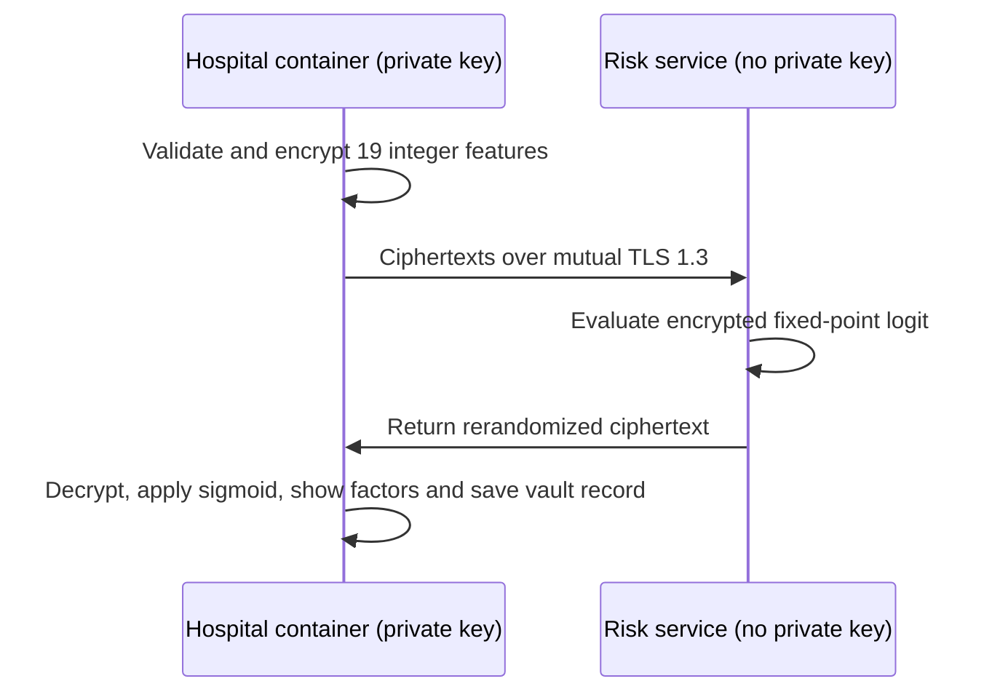
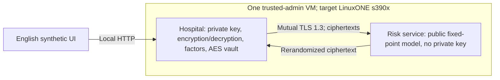

# Privacy-preserving screening

Theme 2 · **AI Secured: Innovation Without Exposure** · IBM Z Datathon 2026.

The hospital encrypts its 21 screening indicators and keeps the private key. A risk service designed for IBM LinuxONE evaluates a logistic model on ciphertexts. The hospital decrypts the score and displays contributing factors. Granite explanations remain an unimplemented optional extension.

[Pitch](../submission/Los_Antimarrulla_Screening_Pitch.pptx) · [decision](DECISION.md) · [sources](DATA_SOURCES.md) · [delivery plan](DELIVERY_PLAN.md).

## 1. Problem and population limits

| Figure | Source/definition |
|--------|-------------------|
| 18.3% of Mexican adults have diabetes | ENSANUT 2022, Basto-Abreu et al., Salud Pública de México, 2023 |
| About one in three is undiagnosed | ENSANUT: 5.8% undiagnosed out of 18.3% total |
| 112,577 registered diabetes deaths in 2024, 13.7% of all deaths; second leading cause | DGIS/INEGI E10–E14 microdata count |
| 120,385 reported sector discharges; 62,771 in the separate SSA extract | Sector SSA/IMSS-Bienestar count is 62,635; the 136-record discrepancy remains unreconciled |
| 11,550 SSA diabetes discharges (18.4%) with lower-limb amputation | 11,759 ICD-9 84.1x procedures; admissions and procedures are not unique people |
| 4.7% in-hospital mortality and mean stay 5.1 days | SSA diabetes admission records |

The 2024 state indicator is about 22 deaths per 100 newly notified cases, 44.3 in Michoacán and 8.7 in Sinaloa. Deaths come from different cohorts than newly notified cases. This ecological ratio is **not case fatality, underdiagnosis or delay** and is not age adjusted. Notification differs across institutions. The independent care-stage sources do not measure people lost along a common pathway.

The project addresses disclosure concerns when hospitals ask an external service to evaluate patient indicators. It demonstrates a technical boundary, not a clinical outcome or legal compliance certification.

## 2. Four-step solution

Training uses public CDC data. Patient inputs arrive at the risk service only as ciphertexts. Screening prioritizes follow-up glucose testing; it does not diagnose disease or predict future diabetes/mortality.

## 3. Cryptographic and numerical design

Paillier provides `Enc(a)*Enc(b)=Enc(a+b)` and `Enc(a)^k=Enc(k*a)`. A logistic model is `sigmoid(w·x+b)`. Public model weights remain plaintext; the service evaluates only the encrypted linear score, and the hospital applies the sigmoid after decryption.

### Numerical contract

| Component | Rule |
|-----------|------|
| Feature order | HighBP, HighChol, CholCheck, BMI, Smoker, Stroke, HeartDiseaseorAttack, PhysActivity, Fruits, Veggies, HvyAlcoholConsump, AnyHealthcare, NoDocbcCost, GenHlth, MentHlth, PhysHlth, DiffWalk, Sex, Age, Education, Income. Exclude ID. |
| Validation | Exactly 21 named fields. Reject missing/extra/empty/boolean/fractional/non-finite/out-of-range values as a whole record. |
| Ranges | Binary fields 0–1; BMI 12–98; GenHlth 1–5; MentHlth/PhysHlth 0–30; Age 1–13; Education 1–6; Income 1–8. |
| Hospital transform | None: original integer codes, input scale 1. Fit standardization on training only and fold it into exported weights/intercept: w'_i=w_i/sigma_i; b'=b−sum(w_i*mu_i/sigma_i). |
| Quantization | W_i=round(10^9*w'_i), B=round(10^9*b'). Inputs are not rounded again. |
| Paillier exponent | Zero for all encrypted inputs and integer operations; do not encode input magnitude in differing exponents. |
| Evaluation | Enc(z)=product(Enc(x_i)^W_i)*Enc(B) modulo n², with z=sum(W_i*x_i)+B. |
| Negative values | Signed integers use phe's encoding modulo n. |
| Overflow | Require sum(M_i*abs(W_i))+abs(B) < public_key.max_int, where M_i is each allowed absolute feature maximum. Include the intercept; reject a model that violates the bound. |
| Decryption | logit=z/10^9, probability=sigmoid(logit). |
| Exactness check | Decrypted z must equal the same-input fixed-point integer reference exactly. |
| Quantization check | abs(logit_fixed−logit_float) <=0.5*(sum(abs(x_i))+1)/10^9, at most approximately 1.03e−7 over schema ranges. Sigmoid error is at most one quarter of the logit bound. Report observed error and AUC difference separately. |

The English protocol is **screening-paillier-v2**. JSON requests carry `protocol`, `schema`, `model`, `id`, `key_public: {n}`, `exponent` and 21 decimal-string `ciphertexts`. Responses carry version/model/schema/ID, exponent and decimal-string `result`; service metadata may add evaluation time. Deploy both endpoints and the UI together. The 32-hex-character request ID is validated with fullmatch. Public-key size is constrained to 2048–4096 bits, and ciphertexts must belong to the key's group.

Rerandomize the returned ciphertext with `obfuscate`. The hospital decrypts only matching outstanding requests, once each; it is not an arbitrary decryption endpoint. Paillier's malleability and the library's [security caveats](https://python-paillier.readthedocs.io/en/stable/caveats.html) limit this demonstration; it is not a production cryptographic certification.

### Protection layers and visibility

| Layer | Mechanism | Evidence/scope |
|-------|-----------|----------------|
| In transit | Mutual TLS 1.3, client certificate required | Actual TLS negotiation and certificate checks |
| At rest | AES-256-GCM hospital vault, 32-byte external key, random 96-bit nonce and record-ID AAD | Vault tamper tests and in-application timings; operational metadata logs remain plaintext |
| In use at risk service | 2048-bit Paillier inference | Exact decrypted integers, ciphertext-only wire evidence |

| Component | Patient inputs | Risk result |
|-----------|----------------|-------------|
| Hospital | Plaintext owned by the hospital | Plaintext |
| Risk service | Ciphertexts only | Ciphertext only |
| Hospital vault records | AES-256-GCM | AES-256-GCM |
| Operational logs | No input records; IDs/timings/bytes | No plaintext result |
| VM disks/backups | Not encrypted by this application | Depends on external configuration, not established here |
| Optional Granite, not integrated | Only minimal hospital-provided context, if implemented | Would see decrypted result inside hospital boundary |
| Hospital-host administrator | Can access hospital memory/storage | Trusted within the demo boundary |

**Approved demo boundary:** two containers share one VM. This does not protect hospital data/keys against that host administrator. Use synthetic demo inputs. Intended production separation places the hospital component on hospital infrastructure; it is a design, not a deployed clinical system.

### CPACF evidence

Record `lscpu`, `cpacfinfo` if installed, CLI `openssl version -a`, and the OpenSSL version used by `cryptography`. Measure AES-256-GCM inside the application. CLI `openssl speed` alone measures a different executable/library path. CPACF can accelerate AES, not Paillier; it is not Secure Execution, an AI accelerator claim or protection from the administrator. Actual use remains unmeasured.

Paillier/phe is the reliable MVP. CKKS through TenSEAL/OpenFHE is optional and unimplemented; lack of an s390x wheel must not delay the MVP.

## 4. Architecture and implementation

Python 3.12, scikit-learn, phe/gmpy2, cryptography, Docker Ubuntu 24.04 and Make. Images support amd64, arm64 and s390x. The app stage excludes CDC, tests and sklearn; the dev stage supports verification. Big-integer modular exponentiation is a substantial compute workload. Current throughput is measured sequentially, concurrency one; no unmeasured batch/parallel scaling claim is made.

## 5. Data and evaluation

CDC UCI 891: 253,680 survey records, 19 model predictors (schema `cdc19-v1`; Education and Income dropped from 21) and 13.9% positive labels. SINAVE, INEGI/DGIS, SIS, IMSS and CONAPO support Mexican context. Their populations, residence/treatment geography, years and count units differ. See [DATA_MODEL.md](DATA_MODEL.md).

LogisticRegression uses lbfgs, C=1, max_iter=5000 and no class weighting. Shared stratified 70/15/15 splits use seed 2026. Validation selects threshold about 0.1218 for sensitivity >=0.80 with maximum specificity.

| Split | ROC-AUC | AP | Sensitivity | Specificity | PPV | Brier | ECE |
|-------|--------:|---:|------------:|------------:|----:|------:|----:|
| Validation, 38,052 | 0.818 | 0.398 | 0.800 | 0.686 | 0.292 | 0.100 | 0.014 |
| Test, 38,052 | 0.825 | 0.414 | 0.807 | 0.689 | 0.296 | 0.098 | 0.012 |

Test confusion counts: TP 4,280; FN 1,022; TN 22,547; FP 10,203. AP is sklearn average precision, not trapezoidal PR area. ECE uses ten equal-sized probability bins.

Balanced class weighting gives similar AUC (0.826) but higher mean probability (0.386 against 0.139 prevalence), Brier 0.175 and ECE 0.246. The exported unweighted model's observed calibration does not guarantee calibration in another population.

There are 60,142 identical feature/label rows over the 19 model features; 10,865 test rows have an identical training counterpart. They may represent different people with the same categorical responses. Deduplicated training uses 140,508 rows and produces nearly unchanged test AUC/AP/Brier (0.824/0.411/0.099). Fixed-point test error is at most about 3.8e−8 logit, within the applicable 9.1e−8 bound; floating and fixed-point test AUC are identical (0.825233). One of 38,052 test records lies within that error of the threshold and flips its decision. XGBoost is untrained and optional.

### Historical measurements and new release evidence

Historical files under `submission/evidencias/metricas/` retain their original language, hashes and commit labels. At `7937f9f`, the clean local two-container API had 129 ms p50/137 ms p95, about 461 patients/min; its process sample matched 2,000/2,000 fixed-point integers with AUC 0.808. At `65ae4ef`, the same-sized local sample matched exactly with AUC 0.808383; deployed API p50/p95 were 141.29/180.039 ms. Differences are observed runs, not tuned performance targets.

The initial 094045Z measurement had a provenance defect and remains historical. The English release changes source and metadata hashes. New evidence belongs under `submission/evidence/metrics/` and must identify its actual commit/environment; the old records are not evidence of this new commit.

The full 38,052-person test set would require 799,092 input ciphertexts. Select a reproducible stratified encrypted sample based on the actual VM budget, and compare all variants on that exact sample. Report composition, integer error, logit/probability quantization error, AUC/AP, validation-threshold sensitivity/specificity, calibration, per-component latency, request sizes and sequential throughput. `make measure` is a process experiment; `make measure-api` exercises deployed hospital API, mutual TLS, service, decryption/interpretation and vault, excluding the browser. The direct two-host audit excludes UI API/vault and is a different operation.

The [ENSANUT experiment](ENSANUT_EXPERIMENT.md) uses a distinct reduced ten-feature model with a different label and approximate mapping. Weighted AUC is 0.767, with risk underestimation and sensitivity 0.46–0.49. It does not validate the MVP or demonstrate detection of undiagnosed disease, prospective outcomes or fewer complications.

## 6. Demo and delivery

Left: 19 ciphertexts and returned encrypted score. Right: hospital probability, threshold decision and five largest contributions relative to training means. Bottom: actual per-request encryption/network/decryption/vault/total timings. Contributions are not causal explanations. Granite is not integrated.

Follow the preserved rest rota and checkpoints: labs H1–3, encrypted handoff before H11, H12 flow check, H18 demo, H20 freeze and H24 internal submission. The actual chronology remains separately recorded. E5 forecasts 222 series at 52 weeks plus bridge steps and is optional; see [FORECAST.md](FORECAST.md).

| Risk | Response |
|------|----------|
| CKKS cannot build on s390x | Keep Paillier |
| Encrypted inference is slow | Use the linear 19-feature model and measured sample sizes |
| Medical claims exceed evidence | Say screening and retain population/label limits |
| Granite is slow or unavailable | Keep the existing factor display; extension remains optional |
| Class imbalance | Report AP, sensitivity/specificity and calibration at a validation threshold |
| Language migration mixes endpoints | Pin/rebuild/deploy both v2 endpoints together and rerun verification |
