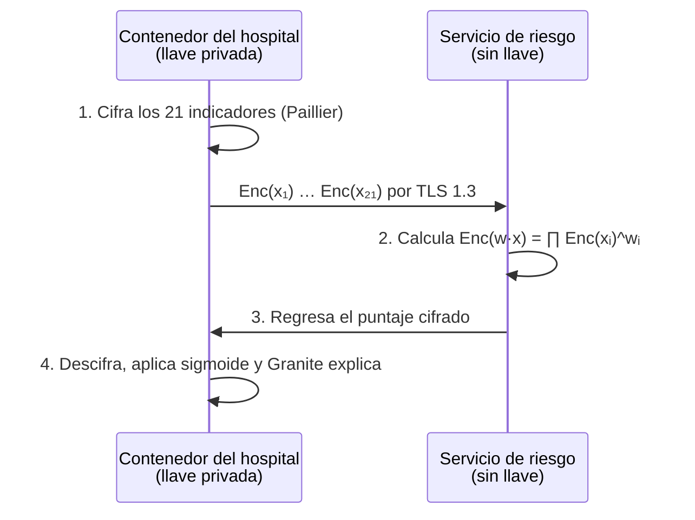
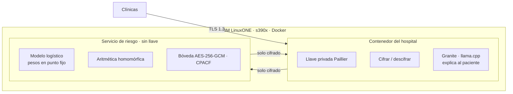

# 🩺 Tamizaje a ciegas

> **La IA ve el riesgo. Nadie ve al paciente.**
> Tema 2 · AI Secured: Innovation Without Exposure · IBM Z Datathon 2026

Una IA que calcula el riesgo de diabetes **sobre datos cifrados** en IBM LinuxONE. El hospital cifra los indicadores de cada paciente y se queda con la llave; el servidor calcula el riesgo sin poder leer nada; el hospital descifra el resultado y un modelo generativo lo explica en lenguaje claro.

Pitch: [submission/Los_Antimarrulla_Pitch_Tamizaje.pptx](../submission/Los_Antimarrulla_Pitch_Tamizaje.pptx) · Decisión: [DECISION.md](DECISION.md) · Datos: [FUENTES_DATOS.md](FUENTES_DATOS.md)

---

## 1. El problema

| Dato | Fuente |
|------|--------|
| **18.3%** de los adultos en México vive con diabetes | ENSANUT 2022 (Basto-Abreu et al., *Salud Pública de México*, 2023) |
| **1 de cada 3** casos no está diagnosticado (5.8% de 18.3%) | ENSANUT 2022 |
| **112,577** muertes por diabetes registradas en 2024 (13.7% de todas): **2.ª causa de muerte** del país | Defunciones registradas 2024, microdatos DGIS/INEGI (conteo propio de `causa_def` E10–E14) |
| **62,771** hospitalizaciones por diabetes en 2024 solo en unidades de la Secretaría de Salud / IMSS-Bienestar | Egresos hospitalarios SSA 2024, DGIS (conteo propio) |
| **11,550** de esas hospitalizaciones (**18.4%**) incluyeron una **amputación de miembro inferior** | Egresos hospitalarios SSA 2024, DGIS (conteo propio) (procedimientos CIE-9 84.1x) |
| **4.7%** de los hospitalizados por diabetes murió en el hospital; estancia media de 5.1 días | Egresos hospitalarios SSA 2024, DGIS (conteo propio) |

Los hospitales tienen los datos para detectar el riesgo antes, pero **no pueden compartirlos**: hacerlo es un riesgo legal y de privacidad; no hacerlo significa detectar tarde.

## 2. La solución en 4 pasos



- **Es tamizaje, no diagnóstico:** prioriza a quién hacerle una prueba de glucosa.
- **El modelo se entrena con datos públicos** (CDC). Los datos de pacientes solo llegan cifrados.

## 3. Diseño criptográfico

### La propiedad que lo hace posible (Paillier)

```
Enc(a) · Enc(b)  =  Enc(a + b)
Enc(a) ^ k       =  Enc(k · a)
⇒  ∏ Enc(xᵢ) ^ wᵢ  =  Enc(w · x)
```

Una regresión logística es `σ(w·x + b)`. El servidor calcula `Enc(w·x + b)` sin descifrar; el hospital descifra el puntaje y aplica la sigmoide. Los pesos y las variables se codifican en **punto fijo** (enteros escalados), que `python-paillier` maneja con su `EncodedNumber`.

### Tres capas de cifrado

| Capa | Mecanismo | Evidencia para jueces |
|------|-----------|-----------------------|
| En tránsito | TLS 1.3 entre contenedores | Configuración del servicio |
| En reposo | AES-256-GCM vía OpenSSL / `cryptography` (CPACF en IBM Z) | `openssl speed -evp aes-256-gcm` en la VM |
| En uso | Paillier de 2048 bits: se calcula sin descifrar | Pantalla dividida + logs sin datos en claro |

### ¿Quién ve qué?

| Componente | Datos del paciente | Resultado de riesgo |
|------------|--------------------|---------------------|
| Hospital (tiene la llave privada) | En claro: son sus pacientes | En claro |
| Servicio de riesgo en LinuxONE | **Solo números cifrados** | **Solo cifrado** |
| Disco, logs y respaldos | **Cifrado AES-256-GCM** | **Cifrado AES-256-GCM** |
| Equipo Antimarrulla | **Nada** | **Nada** |

### Ruta garantizada vs. ruta ambiciosa

| Ruta | Tecnología | Por qué |
|------|------------|---------|
| **Garantizada** | Paillier con `phe` (python-paillier) | Python puro: corre en s390x sin compilar. Suficiente para regresión logística |
| Ambiciosa | CKKS con TenSEAL u OpenFHE | Permite aproximar la sigmoide cifrada y más modelos. Solo si compila en LinuxONE antes de la **hora 2** |

## 4. Arquitectura en IBM LinuxONE



**Por qué IBM Z:**
- **Cómputo pesado, en serio:** cada paciente implica exponenciaciones modulares con enteros de miles de bits.
- **Seguridad de nivel bancario:** cifrado por hardware (CPACF) y aislamiento entre cargas de trabajo.
- **Escala por lotes:** muchos pacientes en paralelo en una sola plataforma; se mide en vivo.

**Stack:** Python · scikit-learn · python-paillier · TenSEAL/OpenFHE (ruta CKKS) · Granite (llama.cpp) · OpenSSL · Docker · Jupyter Lab ML.

## 5. Datos

| Uso | Fuente | Qué aporta |
|-----|--------|------------|
| Entrenar y evaluar | CDC Diabetes Health Indicators (UCI 891) | 253,680 registros, 21 indicadores, 13.9% positivos |
| Contexto de impacto | Incidencia SINAVE (SUIVE-1) | Casos nuevos de E10, E11–E14, O24.4 por entidad, sexo, edad y semana |
| Contexto de impacto | Mortalidad EDR (INEGI) | Defunciones individuales con causa CIE-10 y variables sociales |
| Contexto de impacto | SIS crónicas (Secretaría de Salud) | Pacientes en tratamiento y **controlados**, HbA1c y pie diabético por unidad médica y mes |
| Contexto de impacto | Detecciones IMSS · egresos ISSSTE · CONAPO | Tamizajes por delegación, hospitalizaciones por diabetes y denominadores de población |

**Slide de impacto:** la [cascada de atención de la diabetes](FUENTES_DATOS.md#5-la-cascada-de-atención-de-la-diabetes) por entidad (detectados → casos nuevos → en tratamiento → controlados → complicaciones → muertes) muestra dónde se pierde la gente y por qué detectar antes importa.

Detalle de variables y cruce entre fuentes en [FUENTES_DATOS.md](FUENTES_DATOS.md).

## 6. Métricas que reportamos

| Métrica | Qué demuestra |
|---------|---------------|
| AUC, recall y F1 en claro | Calidad del modelo (con clases desbalanceadas: 13.9% positivos) |
| **AUC cifrado vs. AUC en claro** | Que la privacidad no cuesta precisión (meta: diferencia ≈ 0) |
| Latencia por paciente | Viabilidad operativa |
| Tamaño del cifrado por paciente | Costo de comunicación |
| Pacientes por minuto en LinuxONE | Escala |

Todas se miden **en vivo en LinuxONE** y se guardan en `submission/evidencias/`.

## 7. Demo (pantalla dividida)

- **Izquierda, "lo que ve el servidor":** cada indicador como un número cifrado ilegible.
- **Derecha, "lo que ve el hospital":** riesgo del paciente, factores principales y explicación de Granite.
- **Abajo:** métricas en vivo.
- **Momento clave:** buscar en los logs del servidor un dato del paciente → cero resultados.

## 8. Plan por horas (sobre [ROLES.md](ROLES.md))

| Hora (Juárez) | Javier · líder + pitch | Yazmin · datos + demo | Álvaro · modelado | Carlos · LinuxONE |
|---------------|------------------------|-----------------------|-------------------|-------------------|
| 0–1 (7:00) | Kick-off y alcance | Descarga CDC 891 | Plan del modelo | Acceso a la VM |
| 1–3 | Labs obligatorios | EDA + incidencia SINAVE | Labs obligatorios | Labs + `pip install phe` en s390x |
| **2** | 🚩 **Decisión CKKS vs. Paillier** | | | Prueba de TenSEAL/OpenFHE |
| 3–8 | README y narrativa | Limpieza y particiones | Regresión logística + XGBoost de referencia | Dos contenedores Docker |
| 8–12 | Guion v1 | Mapa SINAVE/EDR por entidad | Pesos en punto fijo + inferencia Paillier | TLS + bóveda AES-GCM |
| 12–16 | Slides v2 | UI de pantalla dividida | AUC cifrado vs. en claro | Integración de servicio y UI |
| 16–18 | Empuje a demo | Pulido de demo | Métricas finales | Latencia y evidencias |
| **18 (1:00)** | 🚩 **Demo de punta a punta** | | | |
| 18–22 | Video (máx. 3 min) | Video de respaldo | `pip freeze` y reproducibilidad | Capturas y limpieza |
| 22–24 | **Envío (meta 7:00)** | Revisión final | Revisión final | Checklist técnico |

## 9. Riesgos

| Riesgo | Mitigación |
|--------|------------|
| TenSEAL/OpenFHE no compila en s390x | Ruta garantizada con Paillier desde la hora 1 |
| Inferencia cifrada lenta | Modelo lineal, 21 variables, lotes pequeños en la demo |
| Narrativa médica exagerada | Siempre "tamizaje", nunca "diagnóstico" |
| Granite lento en CPU | Respuestas cortas; explicación opcional si no llega |
| Desbalance de clases (13.9%) | Pesos de clase, umbral ajustado y métricas recall/AUC-PR |
