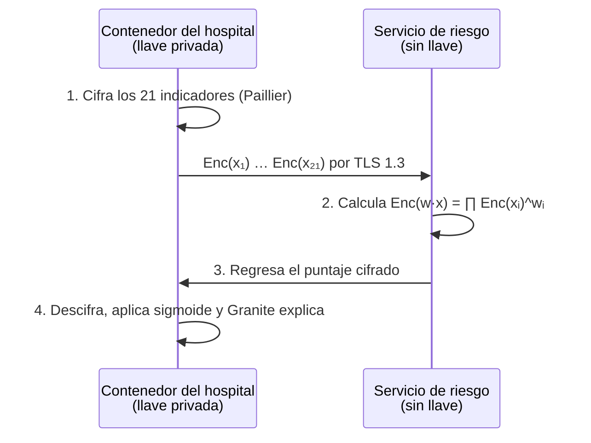
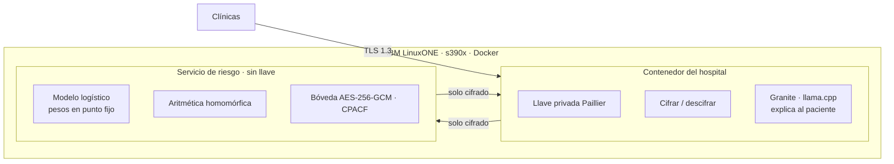

# 🩺 Tamizaje a ciegas

> **La IA ve el riesgo. Nadie ve al paciente.**
> Tema 2 · AI Secured: Innovation Without Exposure · IBM Z Datathon 2026

Una IA que calcula el riesgo de diabetes **sobre datos cifrados** en IBM LinuxONE. El hospital cifra los indicadores de cada paciente y se queda con la llave; el servidor calcula el riesgo sin poder leer nada; el hospital descifra el resultado y un modelo generativo lo explica en lenguaje claro.

Pitch: [submission/Los_Antimarrulla_Pitch_Tamizaje.pptx](../submission/Los_Antimarrulla_Pitch_Tamizaje.pptx) · Decisión: [DECISION.md](DECISION.md) · Datos: [FUENTES_DATOS.md](FUENTES_DATOS.md)

---

## 1. El problema

| Dato | Fuente |
|------|--------|
| **18.3%** de los adultos en México vive con diabetes | ENSANUT 2022 (Basto-Abreu et al., *Salud Pública de México*, 2023) |
| **1 de cada 3** casos no está diagnosticado (5.8% de 18.3%) | ENSANUT 2022 |
| **112,577** muertes por diabetes registradas en 2024 (13.7% de todas): **2.ª causa de muerte** del país | Defunciones registradas 2024, microdatos DGIS/INEGI (conteo propio de `causa_def` E10–E14) |
| **120,385** egresos hospitalarios por diabetes en 2024 en la base sectorial reportada; el archivo SSA registra 62,771 para Secretaría de Salud / IMSS-Bienestar (la base sectorial suma 62,635 para esas instituciones: difieren cobertura y corte) | Egresos hospitalarios SSA 2024, DGIS (conteo propio) |
| **11,550 egresos** SSA por diabetes (**18.4%**) con al menos un procedimiento de **amputación de miembro inferior** (11,759 procedimientos; no son personas únicas) | Egresos hospitalarios SSA 2024, DGIS (conteo propio) (procedimientos CIE-9 84.1x) |
| **4.7%** de los hospitalizados por diabetes murió en el hospital; estancia media de 5.1 días | Egresos hospitalarios SSA 2024, DGIS (conteo propio) |

**Indicador exploratorio:** en 2024 se registraron 22 muertes por cada 100 casos nuevos notificados en el país, con **44 en Michoacán y 9 en Sinaloa**. La razón es aritméticamente correcta, pero **no es letalidad ni mide subdiagnóstico ni retraso**: muertes y casos son cohortes distintas, no está ajustada por edad y la notificación varía por institución ([detalle y límites](FUENTES_DATOS.md#32-muertes-por-cada-100-casos-notificados-por-estado-2024--exploratorio)).

Los hospitales tienen los datos para detectar el riesgo antes, pero **no pueden compartirlos**: hacerlo es un riesgo legal y de privacidad; no hacerlo significa detectar tarde.

## 2. La solución en 4 pasos



- **Es tamizaje, no diagnóstico:** prioriza a quién hacerle una prueba de glucosa.
- **El modelo se entrena con datos públicos** (CDC). Los datos de pacientes solo llegan cifrados.

## 3. Diseño criptográfico

### La propiedad que lo hace posible (Paillier)

```
Enc(a) · Enc(b)  =  Enc(a + b)
Enc(a) ^ k       =  Enc(k · a)
⇒  ∏ Enc(xᵢ) ^ wᵢ  =  Enc(w · x)
```

Una regresión logística es `σ(w·x + b)`. El servidor calcula `Enc(w·x + b)` sin descifrar; el hospital descifra el puntaje y aplica la sigmoide. Los pesos y las variables se codifican en **punto fijo** (enteros escalados), que `python-paillier` maneja con su `EncodedNumber`.

### Protocolo numérico (lo que fija US-3.2)

Los **pesos son públicos y en claro** (se entrenan con datos públicos); solo las variables del paciente van cifradas.

| Paso | Regla |
|------|-------|
| Orden y rango | Vector fijo de 21 variables en el orden de `MODELO_DATOS.md`, con su rango documentado; el esquema se versiona junto con el modelo |
| Escalado | `X_i = round(S_x · x_i)` en el hospital; `W_i = round(S_w · w_i)` en el servidor. Proponemos `S_x = S_w = 10^4` (se ajusta midiendo el error) |
| Intercepto | Se codifica en la escala del producto: `B = round(S_x · S_w · b)` |
| Cálculo cifrado | `Enc(z) = ∏ Enc(X_i)^{W_i} · Enc(B)` (mod `n²`), es decir `z = Σ W_i·X_i + B` |
| Negativos | Los coeficientes negativos se representan módulo `n` (lo resuelve la codificación de `phe`); el hospital decodifica el entero con signo |
| Descifrado | El hospital calcula `logit = z / (S_x·S_w)` y `p = σ(logit)` |
| Exponente | **Fijo por protocolo** antes de transmitir: el exponente de `EncodedNumber` es público y puede filtrar magnitud |
| Prueba de igualdad | Para cada paciente de prueba: `|logit_claro − logit_cifrado| < 1e-6` y `|p_claro − p_cifrado| < 1e-6`; se reporta el error máximo |

**Cuidados de seguridad** (avisos de la [documentación de `phe`](https://python-paillier.readthedocs.io/en/stable/caveats.html)):
- Re-aleatorizar (`obfuscate`) el cifrado del resultado antes de devolverlo.
- El hospital **no descifra cualquier cosa que le manden**: solo resultados del protocolo esperado (evita convertirlo en un oráculo de descifrado, porque los cifrados se pueden manipular homomórficamente).
- `python-paillier` no ha tenido una auditoría criptográfica independiente: es adecuado para una prueba técnica, no para producción.


### Tres capas de cifrado

| Capa | Mecanismo | Evidencia para jueces |
|------|-----------|-----------------------|
| En tránsito | TLS 1.3 entre contenedores | Configuración del servicio |
| En reposo | AES-256-GCM vía OpenSSL / `cryptography` (CPACF en IBM Z) | Ver "Evidencia de CPACF" abajo: `openssl speed` solo mide la CLI |
| En uso | Paillier de 2048 bits: se calcula sin descifrar | Pantalla dividida + logs sin datos en claro |

### Evidencia de CPACF (qué sí prueba algo)

`openssl speed` mide la herramienta de línea de comandos, no a nuestra aplicación: `cryptography` puede traer su propia copia de OpenSSL. En la VM registramos:

1. `lscpu` (arquitectura `s390x`, CPU y memoria asignadas) y `cpacfinfo` si está instalado (funciones CPACF disponibles).
2. `openssl version -a` (CLI) y, desde Python, `cryptography.hazmat.backends.openssl.backend.openssl_version_text()` (la biblioteca que usa la app).
3. Tiempo de cifrar y descifrar con AES-256-GCM **dentro de la aplicación**, con el mismo tamaño de datos que la bóveda.

CPACF acelera AES; **no** acelera Paillier, no es Secure Execution, no protege las llaves frente al administrador del host y no es el acelerador de IA del chip. No lo presentamos como tal.

### ¿Quién ve qué?

| Componente | Datos del paciente | Resultado de riesgo |
|------------|--------------------|---------------------|
| Hospital (tiene la llave privada) | En claro: son sus pacientes | En claro |
| Servicio de riesgo en LinuxONE | **Solo números cifrados** | **Solo cifrado** |
| Disco, logs y respaldos | **Cifrado AES-256-GCM** | **Cifrado AES-256-GCM** |
| Granite (dentro del entorno del hospital) | Solo lo que el hospital le pase (prompt mínimo, sin registro de prompts) | Resultado descifrado |
| Administrador del host donde corra el entorno del hospital | Puede acceder a ese entorno: **es parte de la frontera de confianza** | Ídem |

> **Frontera de confianza:** el servicio de riesgo solo recibe cifrados y no tiene la llave. La llave y Granite viven en el **entorno del hospital**; quien administre ese entorno queda dentro de la frontera de confianza. Dos contenedores en una misma VM **no** protegen frente al administrador del host. **En la demo, los dos contenedores corren en la misma VM de LinuxONE** ([DECISION.md](DECISION.md#decisiones-tras-la-auditoría-externa-17-oct)): el equipo, como administrador de esa VM, queda dentro de la frontera de confianza, y por eso la demo usa solo pacientes sintéticos. En producción, el contenedor del hospital correría en la infraestructura del hospital y a LinuxONE solo llegarían cifrados.

### Ruta garantizada vs. ruta ambiciosa

| Ruta | Tecnología | Por qué |
|------|------------|---------|
| **Garantizada** | Paillier con `phe` (python-paillier) | Python puro: corre en s390x sin compilar. Suficiente para regresión logística |
| Ambiciosa | CKKS con TenSEAL u OpenFHE | Permite aproximar la sigmoide cifrada y más modelos. Solo si compila en LinuxONE antes de la **hora 2** |

## 4. Arquitectura en IBM LinuxONE



**Por qué IBM Z:**
- **Cómputo pesado, en serio:** cada paciente implica exponenciaciones modulares con enteros de miles de bits.
- **Seguridad de nivel bancario:** cifrado por hardware (CPACF) y aislamiento entre cargas de trabajo.
- **Escala por lotes:** muchos pacientes en paralelo en una sola plataforma; se mide en vivo.

**Stack:** Python · scikit-learn · python-paillier · TenSEAL/OpenFHE (ruta CKKS) · Granite (llama.cpp) · OpenSSL · Docker · Jupyter Lab ML.

## 5. Datos

| Uso | Fuente | Qué aporta |
|-----|--------|------------|
| Entrenar y evaluar | CDC Diabetes Health Indicators (UCI 891) | 253,680 registros, 21 indicadores, 13.9% positivos |
| Contexto de impacto | Incidencia SINAVE (`data/sinave/`, en el repo) | Casos nuevos semanales de E10 y E11–E14 por estado y sexo, 2014–2026 |
| Contexto de impacto | Mortalidad EDR (INEGI) | Defunciones individuales con causa CIE-10 y variables sociales |
| Contexto de impacto | SIS crónicas (Secretaría de Salud) | Pacientes en tratamiento y **controlados**, HbA1c y pie diabético por unidad médica y mes |
| Contexto de impacto | Detecciones IMSS · egresos ISSSTE · CONAPO | Tamizajes por delegación, hospitalizaciones por diabetes y denominadores de población |

**Slide de impacto:** la [cascada de atención de la diabetes](FUENTES_DATOS.md#5-la-cascada-de-atención-de-la-diabetes) por entidad (detectados → casos nuevos → en tratamiento → controlados → complicaciones → muertes) muestra dónde se pierde la gente y por qué detectar antes importa.

Detalle de variables y cruce entre fuentes en [FUENTES_DATOS.md](FUENTES_DATOS.md).

## 6. Métricas que reportamos

| Métrica | Qué demuestra |
|---------|---------------|
| AUC y **AUC-PR** en claro | Discriminación con clases desbalanceadas (13.9% positivos) |
| **Sensibilidad y especificidad** a un umbral fijado en validación (no en prueba) | Qué pasaría en un tamizaje real |
| **Calibración** (Brier y curva de calibración) | `class_weight="balanced"` desplaza las probabilidades; sin calibrar no son probabilidades poblacionales |
| **Error numérico cifrado vs. en claro** (máximo y medio, en logit y en probabilidad) | Que el protocolo de punto fijo es correcto |
| **AUC cifrado vs. AUC en claro sobre la misma muestra** | Que la privacidad no cambia la discriminación |
| Latencia por paciente | Viabilidad operativa |
| Tamaño del cifrado por paciente | Costo de comunicación |
| Pacientes por minuto en LinuxONE | Escala |

Todas se miden **en vivo en LinuxONE** y se guardan en `submission/evidencias/`.

**Tamaño de la evaluación cifrada:** el conjunto de prueba completo (15%) son 38,052 personas × 21 variables = **799,092 cifrados** antes de los productos. Primero se mide cuántos pacientes por minuto procesa LinuxONE; con eso se elige una **muestra estratificada** (por ejemplo 1,000–2,000 personas) y se compara claro contra cifrado **exactamente sobre esa muestra**, reportando tamaño y composición.

**Qué afirmamos y qué no:** es una **prueba técnica de inferencia privada**. El modelo clasifica una etiqueta de una encuesta de EE. UU. (prediabetes o diabetes declarada); no demuestra predicción prospectiva, ni detección de diabetes no diagnosticada en México, ni reducción de complicaciones. La validación con población mexicana se hace con ENSANUT (US-3.5); la validación clínica queda fuera del evento.

## 7. Demo (pantalla dividida)

- **Izquierda, "lo que ve el servidor":** cada indicador como un número cifrado ilegible.
- **Derecha, "lo que ve el hospital":** riesgo del paciente, factores principales y explicación de Granite.
- **Abajo:** métricas en vivo.
- **Momento clave:** buscar en los logs del servidor un dato del paciente → cero resultados.

## 8. Plan por horas (sobre [ROLES.md](ROLES.md))

| Hora (Juárez) | Javier · capitán | Álvaro · infra LinuxONE | Carlos · modelado | Yazmin · datos y pitch |
|---------------|------------------|-------------------------|-------------------|------------------------|
| 0–1 (7:00) | Arranque y alcance | Acceso de los 4 a la VM | Plan del modelo | Plan de datos y pitch |
| 1–3 | Capturas de labs | Labs + `pip install phe` en s390x | Labs obligatorios | Labs + EDA del CDC |
| **2** | | 🚩 **Decisión CKKS vs. Paillier** | | |
| 3–8 | Boceto de la UI | Dos contenedores Docker | Regresión logística + XGBoost de referencia | Particiones · cascada y mapa |
| 8–12 | UI de pantalla dividida | TLS + bóveda AES-GCM | Pesos en punto fijo + inferencia Paillier | Slide de impacto |
| 12–16 | UI conectada al servicio | Servicio de riesgo conectado | AUC cifrado vs. en claro | Slides v2 |
| 16–18 | Empuje a demo | Latencia y evidencias | Granite explica el resultado | Guion final |
| **18 (1:00)** | 🚩 **Demo de punta a punta** | | | |
| 18–22 | Checklist · README de la demo | Capturas y revisión técnica | `pip freeze` y reproducibilidad | **Video (2:50)** · PDF del deck |
| 22–24 | **Envío (meta 7:00)** | Revisión final | Revisión final | Revisión final |

## 8.1 Épica E5 · Pronóstico y planeación financiera (Plus)

Pronóstico a **52 semanas** de casos nuevos de diabetes T1 y T2 para las **111 series por tipo, 222 en total** (estado, región y nacional × hombres, mujeres y total), con selección del modelo por SMAPE, respaldo regional para series con pocos casos y un **dashboard de presupuesto** con costo unitario editable. Diseño completo en [PRONOSTICO.md](PRONOSTICO.md).

## 9. Riesgos

| Riesgo | Mitigación |
|--------|------------|
| TenSEAL/OpenFHE no compila en s390x | Ruta garantizada con Paillier desde la hora 1 |
| Inferencia cifrada lenta | Modelo lineal, 21 variables, lotes pequeños en la demo |
| Narrativa médica exagerada | Siempre "tamizaje", nunca "diagnóstico" |
| Granite lento en CPU | Respuestas cortas; explicación opcional si no llega |
| Desbalance de clases (13.9%) | Pesos de clase, umbral ajustado y métricas recall/AUC-PR |
