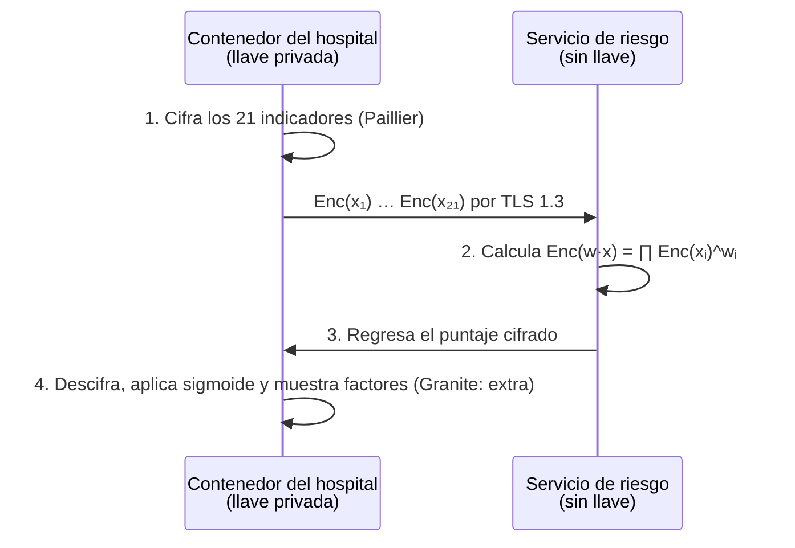
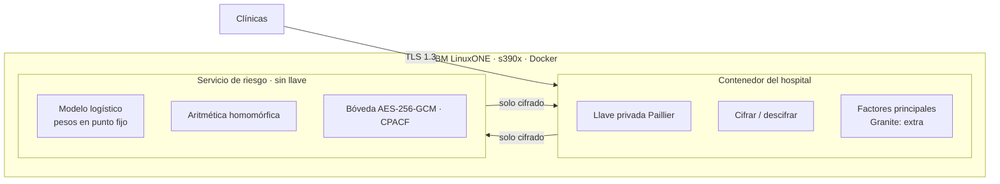

# 🩺 Tamizaje a ciegas

> **La IA ve el riesgo. Nadie ve al paciente.**
> Tema 2 · AI Secured: Innovation Without Exposure · IBM Z Datathon 2026

Una IA que calcula el riesgo de diabetes **sobre datos cifrados** en IBM LinuxONE. El hospital cifra los indicadores de cada paciente y se queda con la llave; el servidor calcula el riesgo sin poder leer nada; el hospital descifra el resultado y un modelo generativo lo explica en lenguaje claro.

Pitch: [submission/Los_Antimarrulla_Pitch_Tamizaje.pptx](../submission/Los_Antimarrulla_Pitch_Tamizaje.pptx) · Decisión: [DECISION.md](DECISION.md) · Datos: [FUENTES_DATOS.md](FUENTES_DATOS.md)

---

## 1. El problema

| Dato | Fuente |
|------|--------|
| **18.3%** de los adultos en México vive con diabetes | ENSANUT 2022 (Basto-Abreu et al., *Salud Pública de México*, 2023) |
| **1 de cada 3** casos no está diagnosticado (5.8% de 18.3%) | ENSANUT 2022 |
| **112,577** muertes por diabetes registradas en 2024 (13.7% de todas): **2.ª causa de muerte** del país | Defunciones registradas 2024, microdatos DGIS/INEGI (conteo propio de `causa_def` E10–E14) |
| **120,385** egresos hospitalarios por diabetes en 2024 en la base sectorial reportada; el archivo SSA registra 62,771 para Secretaría de Salud / IMSS-Bienestar (la base sectorial suma 62,635 para esas instituciones: **diferencia pendiente de reconciliar**) | Egresos hospitalarios SSA 2024, DGIS (conteo propio) |
| **11,550 egresos** SSA por diabetes (**18.4%**) con al menos un procedimiento de **amputación de miembro inferior** (11,759 procedimientos; no son personas únicas) | Egresos hospitalarios SSA 2024, DGIS (conteo propio) (procedimientos CIE-9 84.1x) |
| **4.7%** de los hospitalizados por diabetes murió en el hospital; estancia media de 5.1 días | Egresos hospitalarios SSA 2024, DGIS (conteo propio) |

**Indicador exploratorio:** en 2024 se registraron 22 muertes por cada 100 casos nuevos notificados en el país, con **44 en Michoacán y 9 en Sinaloa**. La razón es aritméticamente correcta, pero **no es letalidad ni mide subdiagnóstico ni retraso**: muertes y casos son cohortes distintas, no está ajustada por edad y la notificación varía por institución ([detalle y límites](FUENTES_DATOS.md#32-muertes-por-cada-100-casos-notificados-por-estado-2024--exploratorio)).

Los hospitales tienen los datos para detectar el riesgo antes, pero **no pueden compartirlos**: hacerlo es un riesgo legal y de privacidad; no hacerlo significa detectar tarde.

## 2. La solución en 4 pasos



- **Es tamizaje, no diagnóstico:** prioriza a quién hacerle una prueba de glucosa.
- **El modelo se entrena con datos públicos** (CDC). Los datos de pacientes solo llegan cifrados.

## 3. Diseño criptográfico

### La propiedad que lo hace posible (Paillier)

```
Enc(a) · Enc(b)  =  Enc(a + b)
Enc(a) ^ k       =  Enc(k · a)
⇒  ∏ Enc(xᵢ) ^ wᵢ  =  Enc(w · x)
```

Una regresión logística es `σ(w·x + b)`. El servidor calcula `Enc(w·x + b)` sin descifrar; el hospital descifra el puntaje y aplica la sigmoide. Los pesos y las variables se codifican en **punto fijo** (enteros escalados), que `python-paillier` maneja con su `EncodedNumber`.

### Protocolo numérico (lo que fija US-3.2)

Los **pesos son públicos y en claro** (se entrenan con datos públicos); solo las variables del paciente van cifradas.

Las 21 variables del CDC son **enteros** (14 binarias 0/1 y siete escalas), así que el hospital no redondea nada: solo el modelo se lleva a punto fijo. Eso deja un único error de cuantización, con cota conocida.

| Paso | Regla |
|------|-------|
| Orden | `HighBP, HighChol, CholCheck, BMI, Smoker, Stroke, HeartDiseaseorAttack, PhysActivity, Fruits, Veggies, HvyAlcoholConsump, AnyHealthcare, NoDocbcCost, GenHlth, MentHlth, PhysHlth, DiffWalk, Sex, Age, Education, Income` (sin `ID`). El esquema se versiona junto con el modelo |
| Validación de entrada | Exactamente las **21 variables**, con estos nombres y en este orden (esquema versionado). Cada valor debe ser un **entero** finito dentro de su rango: binarias 0–1 · `BMI` 12–98 · `GenHlth` 1–5 · `MentHlth` y `PhysHlth` 0–30 · `Age` 1–13 · `Education` 1–6 · `Income` 1–8. Se rechaza el vector completo si falta un campo, sobra uno, viene vacío, es fraccionario, `NaN`/infinito o sale de rango |
| Transformación en el hospital | Ninguna: manda los códigos enteros tal cual (`X_i = x_i`, `S_x = 1`). Si el modelo se entrena con variables estandarizadas, la estandarización se **pliega en los pesos** al exportar: `w'_i = w_i/σ_i` y `b' = b − Σ w_i·μ_i/σ_i`, con `μ` y `σ` del conjunto de entrenamiento |
| Pesos e intercepto | `W_i = round(S_w · w'_i)` y `B = round(S_w · b')`, con **`S_w = 10^9`** |
| Exponente | **0 para todo**: se cifran enteros (`public_key.encrypt(int(x))`) y se multiplican por enteros, así el exponente de `EncodedNumber` es el mismo para todos y no filtra magnitud |
| Cálculo cifrado | `Enc(z) = ∏ Enc(X_i)^{W_i} · Enc(B)` (mod `n²`), es decir `z = Σ W_i·X_i + B` |
| Negativos | Se representan módulo `n` (lo resuelve la codificación de `phe`); el hospital decodifica el entero con signo |
| Desbordamiento | Con `M_i` = máximo absoluto permitido de la variable `i` (1 en binarias, 98 en `BMI`, etc.), se exige **`Σ M_i·|W_i| + |B| < public_key.max_int`** al cargar el modelo (`max_int ≈ n/3`; con llave de 2048 bits, ≈ 2^2046). Si no se cumple, el modelo se rechaza; la comprobación incluye el intercepto |
| Descifrado | El hospital calcula `logit = z / S_w` y `p = σ(logit)` |
| Prueba 1 · cifrado exacto | El entero descifrado debe ser **idéntico** al `z` calculado en claro con los mismos `W_i`, `B` y `X_i` (error 0). Esto prueba el cifrado |
| Prueba 2 · cuantización | Contra el modelo en flotante: `|logit_cuantizado − logit_flotante| ≤ (0.5·Σ|x_i| + 0.5) / S_w ≤ 1.03×10⁻⁷`, y el error en `p` es a lo más un cuarto de eso. Se reporta el error máximo observado y la diferencia de AUC entre flotante y punto fijo |

**Cuidados de seguridad** (avisos de la [documentación de `phe`](https://python-paillier.readthedocs.io/en/stable/caveats.html)):
- Re-aleatorizar (`obfuscate`) el cifrado del resultado antes de devolverlo.
- El hospital **no descifra cualquier cosa que le manden**: solo resultados del protocolo esperado (evita convertirlo en un oráculo de descifrado, porque los cifrados se pueden manipular homomórficamente).
- `python-paillier` no ha tenido una auditoría criptográfica independiente: es adecuado para una prueba técnica, no para producción.


### Tres capas de cifrado

| Capa | Mecanismo | Evidencia para jueces |
|------|-----------|-----------------------|
| En tránsito | TLS 1.3 entre contenedores | Configuración del servicio |
| En reposo | AES-256-GCM vía OpenSSL / `cryptography` (CPACF en IBM Z) | Ver "Evidencia de CPACF" abajo: `openssl speed` solo mide la CLI |
| En uso | Paillier de 2048 bits: se calcula sin descifrar | Pantalla dividida + logs sin datos en claro |

### Evidencia de CPACF (qué sí prueba algo)

`openssl speed` mide la herramienta de línea de comandos, no a nuestra aplicación: `cryptography` puede traer su propia copia de OpenSSL. En la VM registramos:

1. `lscpu` (arquitectura `s390x`, CPU y memoria asignadas) y `cpacfinfo` si está instalado (funciones CPACF disponibles).
2. `openssl version -a` (CLI) y, desde Python, `cryptography.hazmat.backends.openssl.backend.openssl_version_text()` (la biblioteca que usa la app).
3. Tiempo de cifrar y descifrar con AES-256-GCM **dentro de la aplicación**, con el mismo tamaño de datos que la bóveda.

CPACF acelera AES; **no** acelera Paillier, no es Secure Execution, no protege las llaves frente al administrador del host y no es el acelerador de IA del chip. No lo presentamos como tal.

### ¿Quién ve qué?

| Componente | Datos del paciente | Resultado de riesgo |
|------------|--------------------|---------------------|
| Hospital (tiene la llave privada) | En claro: son sus pacientes | En claro |
| Servicio de riesgo en LinuxONE | **Solo números cifrados** | **Solo cifrado** |
| Disco, logs y respaldos | **Cifrado AES-256-GCM** | **Cifrado AES-256-GCM** |
| Granite (extra, aún no integrado; iría dentro del entorno del hospital) | Solo lo que el hospital le pase (prompt mínimo, sin registro de prompts) | Resultado descifrado |
| Administrador del host donde corra el entorno del hospital | Puede acceder a ese entorno: **es parte de la frontera de confianza** | Ídem |

> **Frontera de confianza:** el servicio de riesgo solo recibe cifrados y no tiene la llave. La llave (y Granite, si se integra) viven en el **entorno del hospital**; quien administre ese entorno queda dentro de la frontera de confianza. Dos contenedores en una misma VM **no** protegen frente al administrador del host. **En la demo, los dos contenedores corren en la misma VM de LinuxONE** ([DECISION.md](DECISION.md#decisiones-tras-la-auditoría-externa-17-oct)): el equipo, como administrador de esa VM, queda dentro de la frontera de confianza, y por eso la demo usa solo pacientes sintéticos. En producción, el contenedor del hospital correría en la infraestructura del hospital y a LinuxONE solo llegarían cifrados.

### Ruta garantizada vs. ruta ambiciosa

| Ruta | Tecnología | Por qué |
|------|------------|---------|
| **Garantizada** | Paillier con `phe` (python-paillier) | Python puro: corre en s390x sin compilar. Suficiente para regresión logística |
| Ambiciosa | CKKS con TenSEAL u OpenFHE | Permite aproximar la sigmoide cifrada y más modelos. Extra: en la hora 2 se comprueba si está disponible en LinuxONE; si no, se sigue con Paillier |

## 4. Arquitectura en IBM LinuxONE



**Por qué IBM Z:**
- **Cómputo pesado, en serio:** cada paciente implica exponenciaciones modulares con enteros de miles de bits.
- **Seguridad de nivel bancario:** cifrado por hardware (CPACF) y aislamiento entre cargas de trabajo.
- **Escala por lotes:** muchos pacientes en paralelo en una sola plataforma; se mide en vivo.

**Stack implementado:** Python 3.12 · scikit-learn · python-paillier + gmpy2 · cryptography (TLS 1.3 mutuo, AES-256-GCM) · Docker sobre Ubuntu 24.04 (amd64, arm64, s390x) · `make`. Extras aún no usados: TenSEAL/OpenFHE (CKKS) y Granite (llama.cpp).

## 5. Datos

| Uso | Fuente | Qué aporta |
|-----|--------|------------|
| Entrenar y evaluar | CDC Diabetes Health Indicators (UCI 891) | 253,680 registros, 21 indicadores, 13.9% positivos |
| Contexto de impacto | Incidencia SINAVE (`data/sinave/`, en el repo) | Casos nuevos semanales de E10 y E11–E14 por estado y sexo, 2014–2026 |
| Contexto de impacto | Mortalidad EDR (INEGI) | Defunciones individuales con causa CIE-10 y variables sociales |
| Contexto de impacto | SIS crónicas (Secretaría de Salud) | Pacientes en tratamiento y **controlados**, HbA1c y pie diabético por unidad médica y mes |
| Contexto de impacto | Detecciones IMSS · egresos ISSSTE · CONAPO | Tamizajes por delegación, hospitalizaciones por diabetes y denominadores de población |

**Slide de impacto:** la [cascada de atención de la diabetes](FUENTES_DATOS.md#5-la-cascada-de-atención-de-la-diabetes) por entidad pone lado a lado cifras de **etapas distintas** (detecciones, casos nuevos, pacientes en tratamiento y controlados, egresos y muertes). Vienen de fuentes y poblaciones diferentes: **no** siguen a las mismas personas ni miden cuántas se pierden entre etapas; dan contexto de la carga de la enfermedad.

Detalle de variables y cruce entre fuentes en [FUENTES_DATOS.md](FUENTES_DATOS.md).

## 6. Métricas que reportamos

| Métrica | Qué demuestra |
|---------|---------------|
| AUC y **AUC-PR** en claro | Discriminación con clases desbalanceadas (13.9% positivos) |
| **Sensibilidad y especificidad** a un umbral fijado en validación (no en prueba) | Qué pasaría en un tamizaje real |
| **Calibración** (Brier y curva de calibración) | `class_weight="balanced"` desplaza las probabilidades; sin calibrar no son probabilidades poblacionales |
| **Error numérico cifrado vs. en claro** (máximo y medio, en logit y en probabilidad) | Que el protocolo de punto fijo es correcto |
| **AUC cifrado vs. AUC en claro sobre la misma muestra** | Que la privacidad no cambia la discriminación |
| Latencia por paciente | Viabilidad operativa |
| Tamaño del cifrado por paciente | Costo de comunicación |
| Pacientes por minuto en LinuxONE | Escala |

Las del modelo vienen de `make modelo` (`artefactos/metricas/modelo_logistico_v1.json`); las del recorrido cifrado, de `make medir`, que etiqueta el entorno donde corrió (`submission/evidencias/metricas/`). Las de LinuxONE se toman al correr ahí ([LINUXONE.md](LINUXONE.md)).

### 6.1 Resultados del modelo (17 oct 2026)

Regresión logística (`lbfgs`, C = 1, sin `class_weight`), estandarización ajustada solo con entrenamiento y plegada en los pesos. Particiones 70/15/15 estratificadas con semilla 2026 (`artefactos/particiones/`). Umbral **0.1225**, fijado en validación (sensibilidad ≥ 0.80 con la mayor especificidad).

| Partición | ROC-AUC | Average precision¹ | Sensibilidad | Especificidad | VPP | Brier | ECE² |
|-----------|--------:|-------------------:|-------------:|--------------:|----:|------:|-----:|
| Validación (38,052) | 0.819 | 0.398 | 0.800 | 0.692 | 0.296 | 0.100 | 0.016 |
| Prueba (38,052) | 0.826 | 0.415 | 0.805 | 0.691 | 0.297 | 0.098 | 0.012 |

Matriz de confusión en prueba: 4,268 VP · 1,034 FN · 22,644 VN · 10,106 FP.

¹ `average_precision_score` de scikit-learn: suma de precisiones ponderada por el incremento de recall; no es el área trapezoidal bajo la curva PR. ² Error de calibración esperado con 10 grupos de igual tamaño.

- **`class_weight="balanced"`** casi no cambia el ranking (ROC-AUC 0.827) pero infla las probabilidades: p media 0.386 contra 13.9% de positivos, Brier 0.175 y ECE 0.246. Por eso el modelo exportado no lo usa y no hace falta calibrador.
- **Duplicados:** 24,206 filas repetidas sin `ID` en todo el CDC; 4,560 filas de prueba tienen una copia idéntica en entrenamiento. Pueden ser respuestas iguales de personas distintas. Entrenando sin duplicados (163,437 filas) el resultado en prueba casi no cambia: ROC-AUC 0.826, AP 0.415, Brier 0.098.
- **Punto fijo:** en las 38,052 filas de prueba, el error máximo del logit frente al flotante es 5.7×10⁻⁸ (cota 9.6×10⁻⁸), el ROC-AUC es idéntico y ninguna decisión cambia en el umbral.
- XGBoost no se entrenó: queda subordinado a la logística.

### 6.2 Recorrido cifrado (medición local, no LinuxONE)

Medido el 17 oct en macOS arm64 (12 CPU, Python 3.12, `phe` 1.5.0 con `gmpy2`, llave de 2048 bits), sobre **2,000 pacientes** de prueba (muestra estratificada con semilla 2026: 279 positivos): **2,000 de 2,000** enteros descifrados idénticos a la referencia; error máximo del logit 4.5×10⁻⁸ (cota 7.9×10⁻⁸); ROC-AUC **0.808** igual en flotante, punto fijo y cifrado. Tiempos p50/p95: cifrar 114/127 ms, evaluar sobre cifrados 8.3/9.8 ms, descifrar 1.6/2.1 ms; recorrido completo por HTTPS con TLS 1.3 mutuo y bóveda, 128/148 ms (≈ 459 pacientes/min en secuencia). Solicitud de 26.8 KB y respuesta de 1.4 KB. **No es velocidad de LinuxONE.** Archivo: `submission/evidencias/metricas/medicion_local-darwin-arm64_20261017T094045Z.json`.

**Tamaño de la evaluación cifrada:** el conjunto de prueba completo (15%) son 38,052 personas × 21 variables = **799,092 cifrados** antes de los productos. Primero se mide cuántos pacientes por minuto procesa LinuxONE; con eso se elige una **muestra estratificada** (por ejemplo 1,000–2,000 personas) y se compara claro contra cifrado **exactamente sobre esa muestra**, reportando tamaño y composición.

**Qué afirmamos y qué no:** es una **prueba técnica de inferencia privada**. El modelo clasifica una etiqueta de una encuesta de EE. UU. (prediabetes o diabetes declarada); no demuestra predicción prospectiva, ni detección de diabetes no diagnosticada en México, ni reducción de complicaciones. La evaluación externa exploratoria con ENSANUT (US-3.5, extra) se hizo como experimento aparte con protocolo publicado antes de evaluar ([ENSANUT_EXPERIMENTO.md](ENSANUT_EXPERIMENTO.md)): un modelo reducido de 10 variables tiene ROC-AUC ponderado de 0.767 en adultos mexicanos, pero subestima el riesgo y su sensibilidad cae a 0.46–0.49 con el umbral del CDC. No valida el MVP. La validación clínica queda fuera del evento.

## 7. Demo (pantalla dividida)

- **Izquierda, "lo que ve el servidor":** cada indicador como un número cifrado ilegible.
- **Derecha, "lo que ve el hospital":** riesgo del paciente, decisión frente al umbral y los cinco factores que más mueven el puntaje (la explicación con Granite es un extra aún no integrado).
- **Abajo:** tiempos reales de esa solicitud (cifrar, TLS + servicio, descifrar, total).
- Implementada en `src/tamizaje/ui/index.html`; captura real en `submission/evidencias/local/`.
- **Momento clave:** buscar en los logs del servidor un dato del paciente → cero resultados.

## 8. Plan por horas

El horario completo por persona, con los turnos de descanso y la **regla de extras**, vive en [ROLES.md](ROLES.md). Hitos: labs H1–H3 · recorrido cifrado completo antes de H11 · chequeo en H12 · **demo funcional H18** · congelamiento H20 · envío H24 (meta 7:00).

## 8.1 Épica E5 · Pronóstico y planeación financiera (Plus)

Pronóstico a **52 semanas** de casos nuevos de diabetes T1 y T2 para las **111 series por tipo, 222 en total** (estado, región y nacional × hombres, mujeres y total), con selección del modelo por SMAPE, respaldo regional para series con pocos casos y un **dashboard de presupuesto** con costo unitario editable. Diseño completo en [PRONOSTICO.md](PRONOSTICO.md).

## 9. Riesgos

| Riesgo | Mitigación |
|--------|------------|
| TenSEAL/OpenFHE no compila en s390x | Ruta garantizada con Paillier desde la hora 1 |
| Inferencia cifrada lenta | Modelo lineal, 21 variables, lotes pequeños en la demo |
| Narrativa médica exagerada | Siempre "tamizaje", nunca "diagnóstico" |
| Granite lento en CPU | Respuestas cortas; explicación opcional si no llega |
| Desbalance de clases (13.9%) | Pesos de clase, umbral ajustado y métricas recall/AUC-PR |
